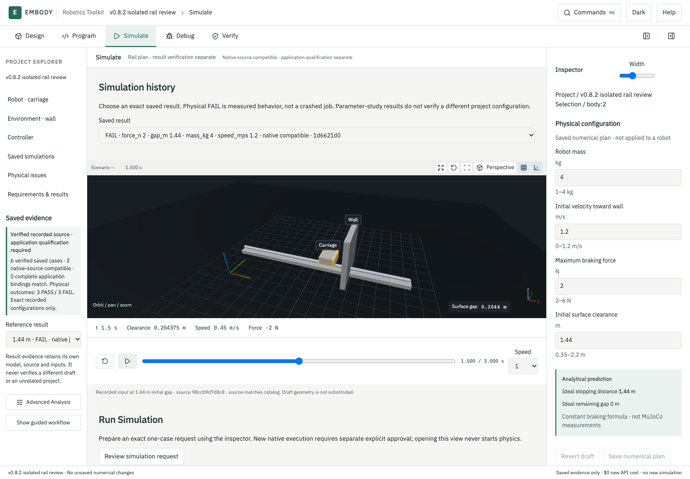
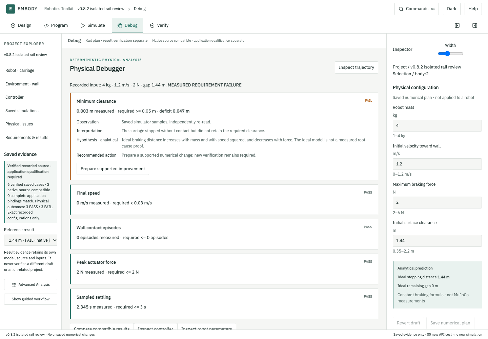

# EMBODY — Build physical intelligence.

Design, inspect controllers, replay simulations and debug physical failures in a
local engineering workspace. **v0.9.1 adds an approval-gated model bridge; v0.8.2 connects saved native results directly to
Design → Simulate → Debug → Verify.** Select a measured rail result in the main
workspace, replay its actual motion, inspect the failed requirement and prepare
a supported change. Rover keeps its model-specific native playback. Existing
advanced tools remain available.



Actual Chrome capture: retained v0.8.1 motion in an isolated numerical review plan;
no new simulation or authoritative application.

**Create → Design → Program → Simulate → Debug → Verify → Iterate**

Open a real example, inspect its physical structure and controller, scrub saved
native motion, understand a failed requirement, and prepare a bounded change.
Measurements keep their original input/source identity. A proposed improvement
stays **verification pending**; review never silently runs physics or applies it.

## Quickstart

Verified locally on macOS Apple Silicon with Python 3.12 and the existing Node
and pinned dependencies. From a reviewed environment:

```sh
npm --prefix frontend run build
.venv/bin/python -m tools.start --check
.venv/bin/python -m tools.start
```

Open http://127.0.0.1:8765. No API key or account is needed. The launcher never
installs dependencies, calls models, launches VMs or runs physics. If setup is
incomplete, see [Quickstart](docs/QUICKSTART.md) and the declared
[Python dependencies](requirements.txt) / [frontend lockfile](frontend/package-lock.json).
Installations remain an explicit operator decision, not a startup side effect.

## Start with a supported example

| Entry | What actually works | Execution scope |
|---|---|---|
| Rail braking | Saved compiled 3D geometry, read-only controller, sample-linked playback, numerical drafts, physical debugger, comparison and adaptive guidance | New execution preparation only; separate explicit approval required |
| Rover / inclined surface | Actual typed nine-part assembly, editable bounded configuration, registered PD controller, requirements, compilation and exact simulation preparation | Saved v0.8.1 nominal PASS and challenging incline FAIL; new execution requires separate approval |
| Controller debugging | Nine genuine public original/repair recordings in the existing Physics Regression Explorer | Historical source inspection and saved-data comparison only |
| Mechanical & circuit studio | Existing typed geometry, environment, SHAPEBASE, CIRCUITBASE and construction review | Independent mechanical project context; no new controller or native model admission |

**New Project** selects Rail braking or Rover / inclined surface. Rover and imported
rail/rover declarations use versioned numeric model projects with exact-head saves;
the earlier rail-plan store remains readable. These are engineering configurations,
not applied mechanical heads. Export/re-import preserves supported numbers and
registered identities without evidence, execution authority or private data.
[Toolkit guide](docs/MULTI_MODEL_TOOLKIT.md) · [configuration examples](examples/robot-projects/README.md).

Private local qualification jobs are not distributed with this repository. A clean
checkout retains the public historical examples; native history stays empty until
legitimate local results exist. Screenshots show retained local qualification data.

## Debug from physical evidence



The debugger reads the actual measurement and its frozen requirement. It separates
**observation, interpretation, analytical hypothesis and recommended action**.
For the selected recorded case, a carriage stopped without wall contact but retained
only 3 mm instead of the required 50 mm: a 47 mm clearance deficit. Replay PASS
means the failure reproduced, not that the physical requirement passed.

Supported checks cover clearance, final speed, contact episodes, peak force and
sampled settling. Missing evidence stays unavailable. An analytical stopping
prediction is never relabelled as a simulator result. Parameter edits remain
local drafts until explicitly saved as a numerical plan; they never change the
original evidence or authoritative mechanical head.

## Investigate with engineering tools · v0.9.1

Open **Engineering assistant** inside a rail or rover inspector. Inspect the
active project and actual saved failure, calculate supported rail predictions,
and validate numerical proposals through the existing typed engine and native
compiler. Review old/new values, retain or reject, then prepare a separately
authorized verification request. Nothing is applied or simulated automatically.

**Local commands remain deterministic.** Live reasoning now has a source-bound
bridge through the existing budgeted Responses adapter, recovered accounting and
explicit approval gate. Prepare a request and review its exact transmitted context,
tools and spending ceiling. The browser cannot approve it. A trusted operator must
record fresh approval before a bounded worker may run. **No genuine model test has
yet qualified this bridge.** Offline tools require no API key. [Workflow, tools and boundaries](docs/ENGINEERING_AGENT.md).

## Genuine native adaptive demonstration · v0.6.2 preserved

| Initial clearance | Minimum measured clearance | Physical verdict |
|---:|---:|---|
| 1.440 m | 0.003 m | FAIL |
| 1.465 m | 0.028 m | FAIL |
| 1.490 m | 0.053 m | PASS |
| 1.540 m | 0.103 m | PASS |

Four distinct cases, eight native MuJoCo rollouts and 4,800 integration steps.
All fresh replays and independent saved-sample verifications passed; every case
finished at zero speed without wall contact. The deterministic engine selected
1.465 m from measured evidence, reducing the observed local interval from
**50 mm to 25 mm (50%)**. This is a sampled transition interval, not an exact
safety boundary or measured superiority over uniform sampling. **1.4775 m
remains unapproved and unexecuted.** The separate v0.8.1 qualification is described below. No new native integration runs during v0.8.2.

[Demonstration](docs/ADAPTIVE_PHYSICAL_DEBUGGING.md) ·
[Portable evidence and readback](examples/adaptive-rail-study/README.md) ·
[Verification scope](docs/VERIFICATION.md)

Historical measurements retain their original source identity. The v0.8.2
read-only integration preserves the v0.8.1 native execution hashes while changing
the wider application binding. Recorded evidence does not qualify changed app
code. Consumed approvals and old certificates grant no new execution authority.

## Recorded multi-model qualification · v0.8.1

The two rail cases at initial gaps 1.440/1.490 m measured 0.003 m FAIL / 0.053 m
PASS. The nominal level rover moved **+16.493 mm** and passed the frozen contract;
its **23.507 mm** error satisfies the 35 mm tolerance for a 40 mm target, rather
than reaching that target exactly. The heavier 10° case moved **−99.590 mm** and
failed progress, target error and wheel-joint ranges. No slip cause is inferred.

Four cases, eight primary/fresh rollouts and 3,200 steps were recorded under the
v0.8.1 source. All fresh replays and independent saved-state checks passed. A
verified physical failure is useful engineering evidence, not a crashed job or
permission to claim arbitrary robots safe. New runtime records remain private;
the public historical example works without private qualification files.

## Program and simulation

Program reuses Monaco to display the actual registered controller read-only. Rail
uses the unchanged velocity brake; rover uses bounded target PD with native wheel-axis
direction. Authority is configured through validated numeric inputs. This
is not arbitrary Python editing/execution, a terminal or controller installation.

Simulate links real saved sample timestamps, compiled geometry and measurement
charts. A request preview validates the existing exact native schema, unchanged
requirements and a model-specific primary/fresh replay budget (rail 600+600; rover 200+200). **The Product Alpha route cannot dispatch,
approve, retry or apply a simulation.** Actual new execution needs a separate
valid source-bound scope. No live AI research is claimed; contextual assistance
is deterministic and does not make provider calls.

## Technical depth remains available

Advanced Analysis retains [Parameter Sweep Lab](docs/PARAMETER_SWEEP_LAB.md),
[Physics Regression Explorer](docs/VERIFICATION.md#physics-regression-explorer),
[Experiment Designer](docs/AI_EXPERIMENT_DESIGNER.md),
[Research Workspace](docs/RESEARCH_WORKSPACE.md), adaptive selection, sensitivity,
controller comparison, evidence graphs, reports and reproducibility.
Returning preserves the rail project, draft and selected evidence. The legacy
workspace retains its own independent project context and pauses hidden playback.

BODYBASE/WORLDBASE supply physical inputs; SHAPEBASE derives bounded geometry and
explicit proxies; CIRCUITBASE checks supported static electrical interfaces.
[Architecture](docs/ARCHITECTURE.md) maps the reused code and trust boundaries.

## Verification and limitations

Run the supported guarded non-native checks with existing dependencies:

```sh
python -B -m tools.research_release_verify
python -B -m pytest -ra -p no:cacheprovider -p tools.non_native_guards tests/test_product_alpha.py tests/test_robot_toolkit.py
npm --prefix frontend test
```

The serial runner includes typecheck/build and excludes live integration/VM tests.
The full historical Python suite needs private archives and includes native
fixtures; it is not the no-execution Product Alpha acceptance command.

[Limitations](docs/LIMITATIONS.md): finite rigid-proxy physics is not hardware,
materials or manufacturing certification. Circuit connectivity is not SPICE or a
coupled powertrain. No arbitrary robot/XML admission, cloud collaboration, automatic
application or unrestricted AI is added. The fixed rover reference is implemented
but requires separate current-source native qualification. Public package
verification establishes integrity/arithmetic, not independently signed origin.
Private runtime folders, approvals, credentials and certificates are not published.

## Roadmap and license

[v0.8 Robotics Developer Toolkit](docs/PRODUCT_ROADMAP.md) implements bounded model/import/controller contracts. Recorded v0.8.1 native
qualification remains verified; modified application qualification is separate. v0.9 targets separately authorized
intelligent engineering; v1.0 targets a coherent installable bounded product.
No customer-acquisition or commercialization work is part of these milestones.
The repository currently has no license grant file; licensing remains the owner's
decision. No commit, tag, push or release is created automatically.

### Follow the measured engineering loop

**Design → Simulate → Debug → Verify.** Open native rail results, select an actual
saved simulation, replay its recorded motion and inspect the exact failed physical
requirement in the main workspace. Historical examples remain separately labelled.
Rover projects retain their model-specific saved 3D playback and requirements.

Compare compatible measured configurations, prepare a bounded change, and review
the next verification request without automatically executing it. A physical FAIL
is useful measured evidence; replay/readback PASS is not the same as robot safety.
Native-source compatibility is distinct from qualification of changed application
code. New execution always requires separate explicit approval.

See the [quickstart](docs/QUICKSTART.md), [product workflow](docs/PRODUCT_ALPHA.md)
and [verification boundaries](docs/VERIFICATION.md). No live AI or unrestricted
robot/controller execution is claimed.
