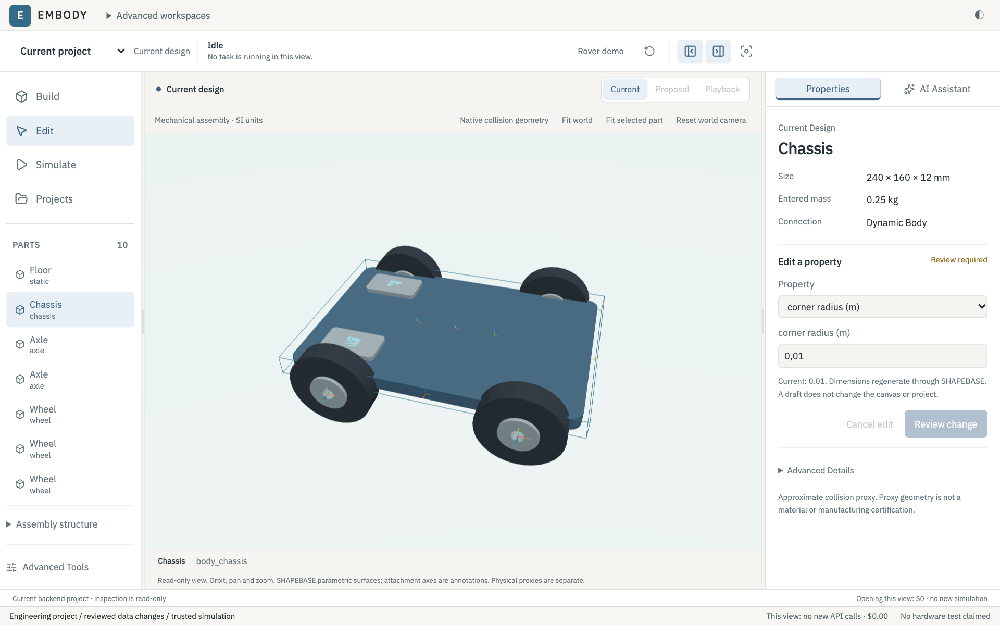
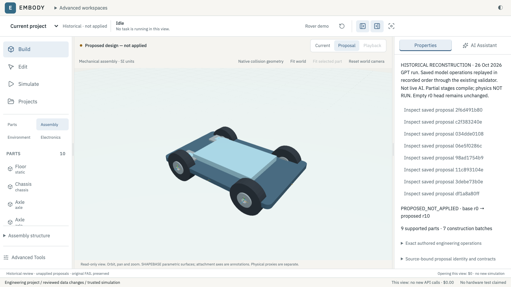
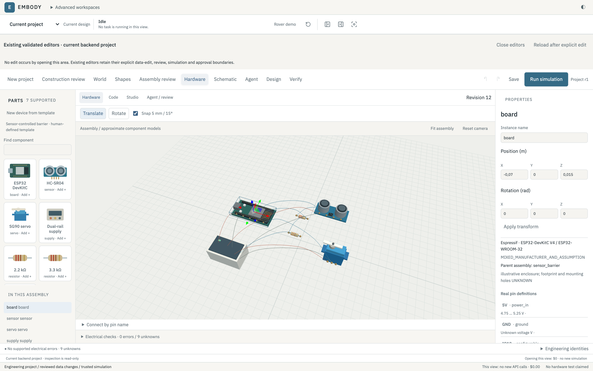

# EMBODY

A local engineering workspace for typed mechanical design, model-directed construction and measured physics.

## Overview

An assembly can look plausible and still be physically wrong. EMBODY connects explicit geometry, mass, joints, actuator limits and circuit interfaces with reviewable engineering operations. It separates a design that compiles from one that has actually passed a supported simulation.

The current prototype combines a React/Three.js studio, a Python engineering API, bounded AI tools and native MuJoCo verification. Model proposals remain copies until a separate human decision. Opening a project or recorded study does not call a model or start physics.

## What it does

- Inspect assemblies, select parts and propose bounded dimensional changes in a shared 3D workspace.
- Generate supported parametric parts with real display holes, named attachment frames and explicit collision proxies.
- Validate complete typed construction plans, including identities, parentage, mounts, mass allocation and actuator bounds.
- Review reference electronics through typed components, pins, nets and static electrical diagnostics.
- Use approved model sessions to propose bounded rover constructions or actuator-command repairs.
- Inspect saved native trajectories, contacts, forces, independent replay and separate failure/repair verdicts.

## Product preview

Saved model-authored rover geometry in a disposable review copy. This is a historical design view, not a newly applied project or a hardware test.

An explanatory historical reconstruction of one preserved model plan, using validated operation prefixes and the existing viewport. The recording-only read adapter is not a new live incremental-build feature. The displayed proposal is unapplied.

Reference electronic context. Graph connectivity does not establish that the circuit powers the rover's numeric simulation commands.

More genuine views: [component editing](docs/assets/product/mechanical-editing.png), [parametric holes and frames](docs/assets/product/shapebase-geometry.png), [signal connections](docs/assets/product/circuit-signal-path.png), [saved AI workflow](docs/assets/product/ai-request-workflow.png), [native verification](docs/assets/product/physics-verification.png) and a [separate reference-ramp test](docs/assets/product/reference-ramp.png).

## Engineering workflow

Natural-language task → structured engineering context → typed operations → validation → copied 3D geometry → explicitly requested native verification, where supported → human review.

An assembly proposal can be rejected before simulation. A compiled design can still fail measured requirements. A successful replay is finite evidence for its own inputs, not permission to apply a proposal.

One saved model-authored rover passed its original proxy checks but moved **−0.018516 m**, failing the required **+0.005 m** forward travel. A separate model-authored rear-command repair measured **+0.018516 m**. The initial failure remains a failure; both designs remain unapplied. See [verification](docs/VERIFICATION.md) and the [compact evidence summary](docs/assets/product/verification-summary.json).

## Architecture

| Area | Actual source |
|---|---|
| Physical contexts and native verification | [core](core/), [physics](physics/), [robot](robot/) |
| World topology and MuJoCo compilation | [world](world/) |
| Parametric parts and attachment constraints | [shapebase](shapebase/) |
| Circuit catalog, graph and static checks | [hardware](hardware/) |
| Typed actions, project persistence and assembly validation | [engineering](engineering/) |
| Local API, authorization bridge and review read models | [ide_api](ide_api/) |
| Model adapters, budgets and execution boundaries | [core/agent](core/agent/) |
| Interactive studio and tests | [frontend](frontend/), [tests](tests/) |

BODYBASE and WORLDBASE supply explicit physical inputs; SHAPEBASE derives bounded display geometry and declared proxies; CIRCUITBASE checks supported electrical interfaces. [Architecture](docs/ARCHITECTURE.md) explains the boundaries.

## Setup

The verified environment is macOS on Apple Silicon, Python 3.12 and Node 22.11, with dependencies declared in [requirements.txt](requirements.txt), the optional requirements files and [frontend/package-lock.json](frontend/package-lock.json).

Dependency setup for a reviewed release bundle:

~~~sh
python3.12 -m venv .venv
.venv/bin/python -m pip install -r requirements.txt
# Required for model-adapter integration and its offline protocol tests:
.venv/bin/python -m pip install -r requirements-openai.txt
npm --prefix frontend ci
~~~

These are setup instructions; this cleanup did not install or download dependencies. The optional `requirements-workspace.txt` is for the legacy Streamlit workspace. Installation alone does not resolve the recording portability gate below.

With the reviewed dependencies and preserved recording bundle available:

~~~sh
npm --prefix frontend run build
.venv/bin/python -m tools.start --check
.venv/bin/python -m tools.start
~~~

Open http://127.0.0.1:8765. Stop the owned server with Ctrl+C. No API key is required for saved review. The launcher does not install packages, run models, launch VMs or execute simulations.

The [portable rail-braking study](examples/rail-braking-study/README.md) supplies the default saved A/B/C evidence and native frames. It is an explicitly derived metadata package, with original source identities and unchanged measurements. The original archives stay private. Advanced saved rover, arm and robustness views require their separate historical archives.

**Security qualification:** these exact worker and qualifier sources passed all 32 containment assertions and trusted A/B/C parity in a separately approved private installation (17 serial attempts, 27 October 2026). This public source tree contains no private runtime, baseline records or certificate and has no VM execution authority. Any local deployment requires its own valid installation-bound qualification and explicit execution approval. [Verification](docs/VERIFICATION.md) separates portable-reader checks from full-workspace regression and release approval.

## Testing

~~~sh
.venv/bin/python -m pytest -ra -m "not live_vm"
npm --prefix frontend test
npm --prefix frontend run typecheck
npm --prefix frontend run build
~~~

The full Python command is for the preserved workspace and includes trusted native regression fixtures; live VMs are explicitly excluded. Some historical integration tests need private archives. The portable saved-data suite is `tests/test_public_recording.py`; it performs no new dynamics. Exact checks and limitations are in [Verification](docs/VERIFICATION.md).

## Development and limits

[Development](docs/DEVELOPMENT.md) follows engineering milestones, with genuine original images and explicitly labelled reconstructions. The categories describe technical work, not an invented calendar or coding diary.

Support is bounded: no general CAD kernel, certified material/manufacturing model, autonomous vehicle, complete electronic powertrain or real-hardware safety proof. Untrusted source execution remains blocked without valid separately approved containment. Read the [limitations](docs/LIMITATIONS.md) before interpreting a simulation PASS.
