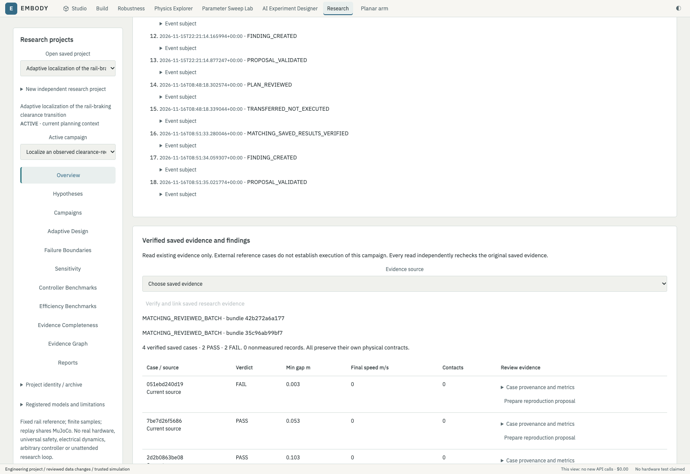
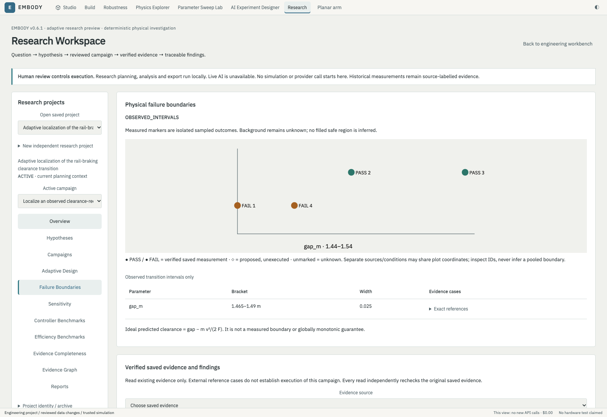
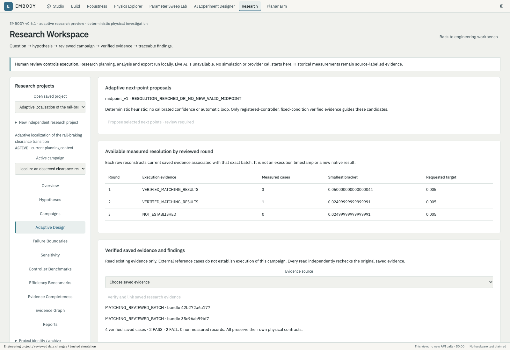
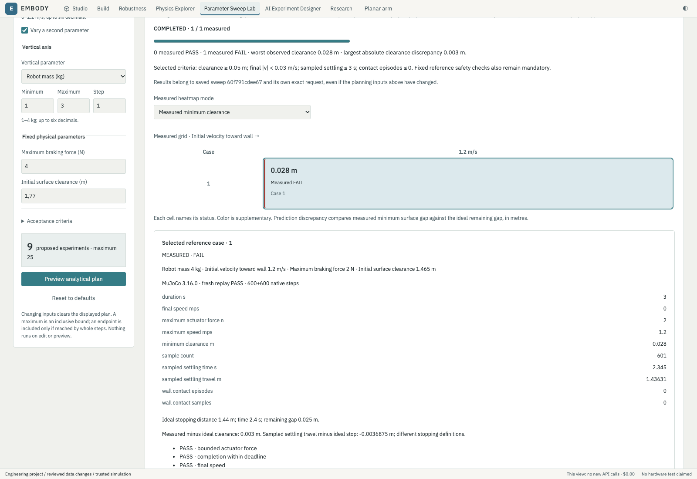

# Verified adaptive physical debugging · EMBODY v0.6.2

**Find a physical failure, verify it, then choose a useful follow-up test.**

An object can stop without a collision and still violate an engineering
requirement. EMBODY's rail-braking demonstration makes that distinction
measurable: a 4 kg carriage approaches a wall at 1.2 m/s with 2 N braking
authority, and must retain at least 50 mm clearance.

## Measured results

| Initial clearance | Minimum measured clearance | Physical verdict |
|---:|---:|---|
| 1.440 m | 0.003 m | FAIL |
| 1.465 m | 0.028 m | FAIL |
| 1.490 m | 0.053 m | PASS |
| 1.540 m | 0.103 m | PASS |

All four cases stopped at zero final speed without wall contacts. The first
two still failed the clearance requirement. Each case used 600 native steps
and a separate fresh 600-step replay: **4 distinct cases · 8 rollouts · 4,800
integration steps**. All four fresh replays and independent saved-sample
verifications passed. Replay PASS verifies reproducibility, not physical success.
Exact floating-point measurements, original check dictionaries and both sample
series are in the [portable study](../examples/adaptive-rail-study/README.md).

Actual Research Workspace capture: verified facts can include a physical failure.

## Evidence-driven follow-up

Three initial measurements at 1.440, 1.490 and 1.540 m established a local
opposite-outcome pair: FAIL at 1.440 m and PASS at 1.490 m. The existing
deterministic midpoint engine selected **1.465 m from those measured records**.
It was not a model-authored guess, manually substituted point or hidden answer.

After separate explicit approval, that one refinement ran through the unchanged
trusted native service and fresh replay. Its 28 mm clearance failed the same
50 mm requirement, replacing the lower observed endpoint:

| Stage | Observed sampled interval | Width |
|---|---|---:|
| Initial measurements | [1.440, 1.490] m | 50 mm |
| After measured refinement | [1.465, 1.490] m | 25 mm |

**The interval width decreased by 50%.** This shows the product value of
preserving failure evidence and selecting a test inside the remaining local
uncertainty. It does not establish information optimality or measured superiority
over uniform/seeded sampling; those comparisons remain separate offline fixtures.

The empty region between markers remains unmeasured. This is an observed sampled
transition interval, not an exact physical safety boundary or a confidence interval.

Two measured rounds are complete. The third row is pending only; the generic
stop label includes the case where a midpoint is already proposed. **The 5 mm
resolution target has not been reached.** The engine's next point, **1.4775 m**,
is unapproved and unexecuted. This release grants no further execution authority.

## Inspectable physics, bounded claims

The selected result records its own exact 4 kg / 1.2 m/s / 2 N / 1.465 m inputs,
separately from unrelated draft planning controls on the left. The application
captures are unchanged 1600×1100 Chrome screenshots from the genuine saved-result
QA, which passed 13 workflow checks with zero page/console errors. Older preview
labels remain visible; no DOM value or evidence was edited for presentation.

This uses the registered **developer-authored velocity brake**, a frictionless
one-axis rigid proxy and MuJoCo 3.16.0. It is deterministic measured research,
not live GPT research or a hardware trial. Replay shares MuJoCo and the same
acceptance definitions; it is not a second-engine proof. Contacts, force bounds,
state, model/source identities and acceptance checks remain independently
inspectable. No frozen execution source or physical requirement changed.

Two existing complete reader-capture exports retain the original primary/replay
bytes and hashes. Selected decoded content and screenshots were privacy-reviewed;
private runtime folders, consents, certificates, local attestations, operator logs,
credentials and personal host paths are excluded. External package verification
establishes integrity and saved arithmetic, not independently signed origin or
permission to execute/apply anything. See [evidence rules](RESEARCH_EVIDENCE.md)
and [verification scope](VERIFICATION.md#v062-verified-native-adaptive-refinement).

This completes the current adaptive refinement milestone. **v0.7 Product Alpha**
is the next development milestone. No v0.7 feature, additional simulation, paid
model call, VM launch, proposal application or publication is part of this release
preparation. Human review and execution approval remain separate.
