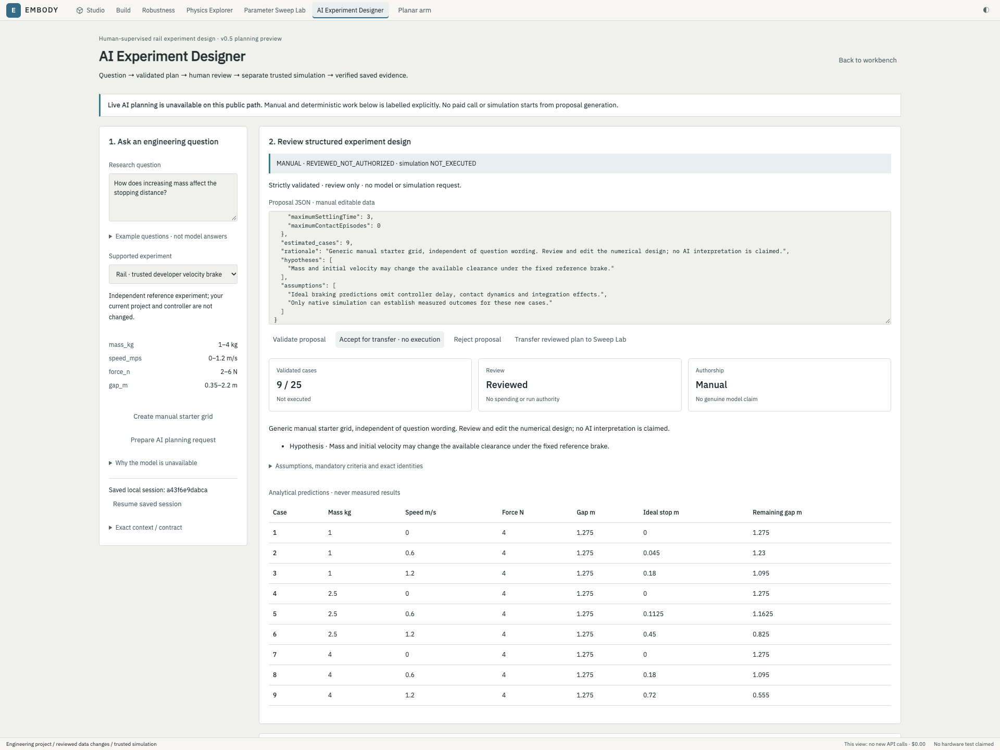
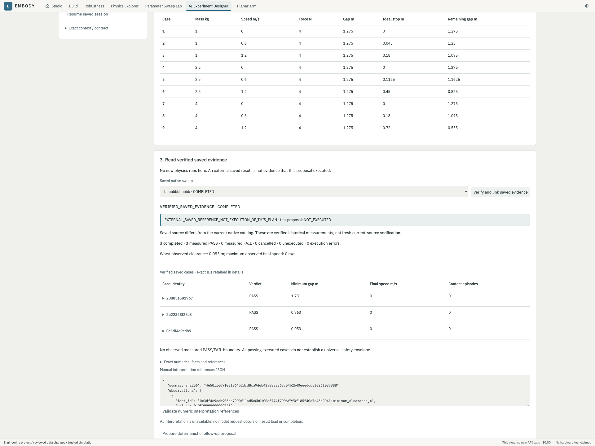

# AI Experiment Designer · validated planning preview

The v0.5 preview connects bounded experiment proposals, review, Parameter Sweep
Lab and verified saved evidence. **Live AI planning and AI interpretation are
unavailable on this public path.** Manual and deterministic work is labelled
explicitly. No new model call or physics run was made to verify this release.

Open **Simulate → Open AI Experiment Designer**, or **Advanced workspaces → AI
Experiment Designer**. This designs an independent trusted rail reference
experiment; it does not modify the current engineering project or controller.

## Supported workflow

1. Enter a rail engineering question. Example questions are prompts for the user,
   not stored model answers. Inspect the current catalog and physical limits.
2. **Prepare AI planning request** reports `MODEL_UNAVAILABLE`, preserving a free
   local session and nonexecutable context packet. It creates no provider client,
   spending authority or native job.
3. **Create manual starter grid** supplies a generic grid independent of question
   wording. Edit its JSON to express the experiment you want. It is not a
   natural-language interpretation or an AI decision.
4. **Validate proposal** checks the whole schema, catalog/context identity, units,
   parameters, exact count and criteria. Errors reject the proposal; they are not
   silently corrected. Review the analytical table, rationale and assumptions.
5. **Accept for transfer · no execution**, or reject it. Any manual edit requires
   validation and review again. A stale proposal requires a new current session.
6. **Transfer reviewed plan to Sweep Lab** rechecks the exact reviewed proposal.
   Its reference-only plan has no invented historical A/B/C or repair identity.
   Edit/review in the Designer before another transfer. The existing native panel
   still requires **Run Simulation Sweep → Confirm and run trusted sweep** and
   independently validates its own request. The Designer never starts it.
7. Explicitly select **Verify and link saved evidence**. External results remain
   external references, not proof that your new plan executed. Exact matching of
   reviewed cases, criteria and current source is required to associate execution.
8. Inspect fact references, validate optional manual numeric observations, prepare
   a separately reviewed deterministic follow-up, or export the session.

The manual starter uses three evenly spaced values from each of the current mass
and speed bounds, midpoint force/gap, and mandatory criteria. This is a declared
starting assumption, not an answer selected by a model. No unattended experiment
or model-call loop exists.

## Proposal contract and validation

`ide_api/experiment_designer.py` owns the versioned strict schema, returned in
`experiment-designer/context`. The live trusted catalog is the source of truth:

- Experiment `rail_velocity_brake_v1`, controller `developer_velocity_brake_v1`.
- Mass 1–4 kg, speed toward wall 0–1.2 m/s, force 2–6 N, surface gap 0.35–2.2 m.
- One or two distinct range axes, at most 25 cases, six-decimal integer stepping.
- The existing 3 s / 0.005 s horizon, 600 primary + 600 replay steps/case,
  serial execution, resource/auth/cancellation rules remain unchanged.

Required proposal fields:

| Field | Meaning |
|---|---|
| `schema_version` | Exactly 1 |
| `research_question` | Exact session question, bounded text |
| `experiment_id`, `controller_id` | Exact registered catalog identifiers |
| `context_sha256` | Current catalog plus planning definitions/source identity |
| `units` | Exact SI mapping for all four physical parameters |
| `axes` | One/two distinct parameter, minimum, maximum and positive step objects |
| `fixed_parameters` | Exact four-field finite physical configuration |
| `criteria` | Bounded selected criteria that cannot weaken mandatory limits |
| `estimated_cases` | Exact deterministic grid count, 1–25 |
| `rationale` | Bounded untrusted engineering prose |
| `hypotheses`, `assumptions` | Bounded arrays of short untrusted text |

Unexpected keys reject. Payload limit is 16,384 bytes; question/rationale at most
1,200 characters, hypotheses at most three and assumptions at most five, each
300 characters. Strict schemas bound nesting and arrays. Common source, path,
URL and credential patterns reject; text is always inert, never evaluated or sent
as an execution payload. Numeric fields do not accept expressions. This is not
semantic proof that arbitrary prose is correct or benign.

Designer criteria can only tighten the original minimum 0.05 m clearance, final
speed strictly below 0.03 m/s, 3 s settling deadline and zero contact allowance.
The native service still independently requires its original complete-horizon,
finite, force/contact and fresh-replay checks. The planner does not own or weaken
those predicates. A proposal, review state or client flag is not execution approval.

Analytical predictions reuse `parameterSweep.ts` in the UI and existing native
numeric validators on the server, with deterministic bounded grid generation.
They calculate F/m, mv²/(2F), mv/F and remaining surface gap under ideal immediate
braking assumptions. They are not simulator measurements or real-world safety.

## Existing AI integration: what works and what is unavailable

The protected `AgentOrchestrator` is controller/patch-oriented. The existing paid
`EngineeringAI` workflow accepts rover assembly and physical repair, requires its
exact model authorization, project context and historical cost reconciliation,
and cannot authorize this new rail task. Its private historical accounting anchor
is absent from the public package. We neither fabricate an empty accounting
history nor add an independent provider/spending client.

The existing `ModelAdapter`, `MockModelAdapter` and `OpenAIResponsesAdapter`
contracts are reused for **offline-only typed protocol tests**. One strict
`propose_experiment` tool returns untrusted arguments to the same validator.
System instructions, user question and numeric context are separate; a final
answer grid is not embedded in model context. Test doubles are labelled
`OFFLINE_PROVIDER_TEST_DOUBLE_NOT_AI`, never model-verified. The production
Designer has no provider-dispatch endpoint or executable paid manifest.

A future live integration needs a separately reviewed rail workflow in the
existing authorization/accounting system, legitimate historical accounting,
exact source/context/tool schemas and token/cost/window limits, and fresh explicit
approval before credentials or transport. Existing approvals are not reused.
No protected agent, budget, VM or qualification code changed. A core change, if
chosen later, needs its own exact review before implementation. No new VM
qualification is implied by this planning feature.

## Verified evidence and interpretation

Saved reads use `RailSweeps.case`, which checks result/model/trajectory hashes.
The Designer recomputes metrics and selected checks from saved samples and checks
saved verdict consistency, source/request identity and analytical discrepancies.
Equivalent floating-point algebra allows only the established 1e−12-scale
comparison tolerance; original saved values are preserved. Missing/corrupt data
fails closed rather than becoming zero or a prediction.

Summaries contain completed/pass/fail/error/cancelled/running/queued/unexecuted
counts, actual metrics, original mandatory and selected outcomes, worst clearance,
maximum final speed, contacts, discrepancies and adjacent measured transitions.
Facts carry `case_id:metric` identities, actual values and units. A physical
boundary requires adjacent verified PASS and FAIL cases with other parameters
fixed; unexecuted/error gaps do not establish it.

Browser verification reused the genuine v0.4 three-case demonstration: minimum
gaps 1.731 / 0.763 / 0.053 m, zero final speeds/contacts, all PASS. **No new measured
failure boundary was observed.** The new API adapter changes the trusted source
identity, so these preserved records are labelled verified saved evidence with a
stale current-source identity. They are not silently migrated or claimed as fresh
v0.5 executions. Their trajectories, receipts and source-bound records remain
unchanged; the consumed six-rollout budget was not reused.

Manual interpretation JSON references the exact summary hash and known fact IDs.
Numbers must equal the referenced saved value; missing values cannot become zero,
unknown references reject, and unsupported safety guarantees reject. Rounded
screen labels may differ from full-precision facts; the editor is seeded with the
exact reference value. Numeric validation does not verify free-form causal
hypotheses. Those remain explicitly unverified and manual, not AI or measurements.
Optional AI interpretation is unavailable and never automatic on result load.

## Follow-ups and session export

**Prepare deterministic follow-up proposal** explores a small bounded gap range
around the worst observed saved case, holding mass, speed and force fixed. It is
an explicit heuristic, not an AI decision or inferred failure boundary. The new
session requires its own validation, human review, transfer and native confirmation.
No recursive calls or simulations occur.

Bounded local sessions live under ignored `.runtime/experiment_designer/`:
32 sessions maximum, 64 immutable review-event snapshots per session and a bounded
200 KB state/export. State pointers update atomically; no historical folders or
project heads change. Resume reads the saved session; no inference or simulation.

`EMBODY_EXPERIMENT_DESIGN_SESSION_V1` export distinguishes proposal source,
validation, review, transfer, actual execution association, evidence references,
manual interpretation and follow-ups. It contains no full trajectory archive,
credentials, absolute paths or certificates. Matching execution is associated
only after explicit verified linking; external evidence leaves the proposal
NOT_EXECUTED.

Sweep Lab exports reference transfers as `EMBODY_REVIEWED_REFERENCE_PLAN_V1`,
with a designer-context identity and trusted-source identity, rather than
pretending that either is a historical recording inventory. Legacy analytical
study exports remain compatible.

## Verification and limitations

Focused tests cover strict/invalid schemas, ranges/units/counts, mandatory safety,
stale identity/review, executable fields, offline valid/malformed/denied model
protocols, verified facts, missing/partial/corrupt results, real-boundary conditions,
interpretation numbers and independent follow-ups. Frontend checks cover real App
navigation, reference transfer, no automatic run, stale native-source blocking,
manual/deterministic labels and session export. Real Chrome exercised the actual
backend and genuine saved evidence; no provider or native integration was enabled.

No genuine live provider behavior is verified. Manual JSON editing is the current
fallback; it does not understand a question or optimize an experiment. General
robot design, geometry/controller changes, autonomous research, causal proof,
remote multi-user approval and real-world safety remain unsupported. Sessions are
local bounded records, not signed remote provenance. Native execution stays solely
in the existing explicitly confirmed trusted service. No paid call, native rerun,
VM, installation or automatic application was performed for this feature.

Final verification: **81 focused non-native Python tests passed** (47 Designer,
34 existing nearby security/admission tests); **133 frontend tests passed**
(13 Designer, 120 nearby). Standalone TypeScript typecheck and production build
passed. Real installed-Chrome QA passed 13 interaction checks with zero page
errors, two expected HTTP400 console responses for deliberate validation failures,
and no blocked/external requests. Screenshots are actual manual planning and
verified historical-evidence views, not live-model output. Instrumented QA guards
recorded zero provider/native calls; the original v0.4 budget was not reused.
