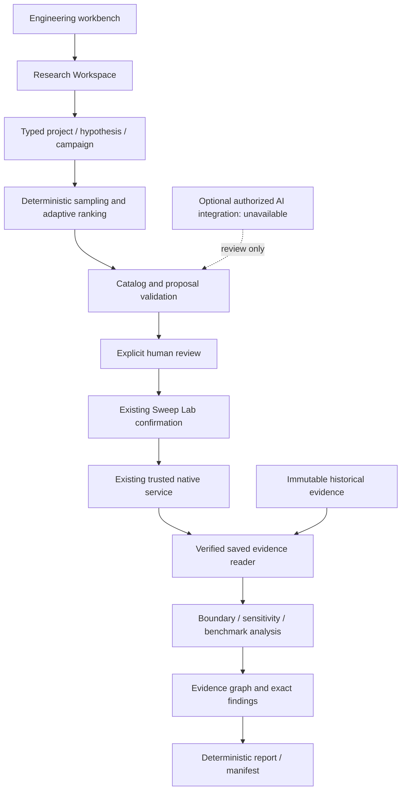

# Architecture

EMBODY uses the existing source layout. Domain documents, engineering proposals and measured evidence have separate identities and permissions.

## Domain models

- **BODYBASE / physical contexts:** [core/bodybase.py](../core/bodybase.py) and [core/worldbase.py](../core/worldbase.py), [configs](../configs/) and [robot](../robot/) define explicit physical parameters, models and task bounds.
- **WORLDBASE:** [world/schema.py](../world/schema.py) validates bodies, parentage, geometry, joints, environment and bounded numeric controls. [world/compiler.py](../world/compiler.py) creates MuJoCo models and independently checks compiled geometry, mass, inertia and generalized actuator forces.
- **SHAPEBASE:** [shapebase/model.py](../shapebase/model.py), [geometry](../shapebase/geometry.py) and [operations](../shapebase/operations.py) keep stable part/body/frame identities. Display holes and nominal profiles are distinct from declared collision proxies. Attachments require actual registered mechanics; a hole does not invent a joint.
- **CIRCUITBASE:** [hardware](../hardware/) owns catalog components, pins, wiring, reference interfaces and supported static electrical checks. Unknown ratings remain unknown.

## Engineering transactions

[engineering/actions.py](../engineering/actions.py) validates bounded typed operations on copied project data. [EngineeringService](../ide_api/engineering.py) exposes proposal/review transactions; [engineering/assembly_plan.py](../engineering/assembly_plan.py) schedules declared dependencies and [assembly validation](../engineering/assembly_validation.py) checks semantic and physical declarations.

Part IDs, body IDs, joint owners and frame IDs are different namespaces. Invalid identities are rejected rather than silently translated. Coupled edits validate their copied final state. Project hashes/revisions prevent stale proposals from being applied to a different head.

Compilation establishes supported structural consistency. Dynamics require their own explicit native run. Proposal generation, physical verification and human application remain separate actions.

## AI and authorization

[ide_api/engineering_ai.py](../ide_api/engineering_ai.py) binds a task to the actual project/selection, frozen tools, source identities and finite scope. Existing inspect/propose facades use the same typed engine; they are not another mutation implementation.

[core/agent](../core/agent/) contains replaceable model adapters, request reservations, usage accounting, proposal validation and execution boundaries. Model-authored revisions must follow actual returned validation feedback. Deterministic examples and mock transport are labelled separately from genuine provider output.

The [studio execution bridge](../ide_api/studio_execution.py) keeps financial approval outside arbitrary browser requests. Exact scope, expiry, source drift, consumed authority and uncertain charges are checked before dispatch. No retry or fallback is inferred from unused budget.

Controller-source proposals use a separate isolation boundary. Source validation and temporary directories are not sandboxes. Expired or mismatched VM qualification blocks execution; neither a saved PASS nor a geometry proposal renews it.

## Workspace and evidence

The [React frontend](../frontend/src/) shares project selection, proposal geometry, component properties and saved playback through the [local API](../ide_api/server.py). The server binds to loopback and checks request origin/shape and mutation tokens. It is a trusted-local-account prototype, not a remote multi-user approval service.

The canvas renders supported geometry and saved measured poses. Scrubbing chooses recorded timestamps; it does not run a solver or create a new physical verdict. [world/simulation.py](../world/simulation.py) owns bounded trusted native dynamics and a separate fresh replay.

Saved-study readers require pinned inputs and hashes. The default [portable rail study](../examples/rail-braking-study/README.md) uses the unchanged reader with a distinct public inventory. A schema-context whitelist derives only path metadata; independent comparison preserves measurements, verdicts, source, XML, traces and saved PNGs. Original archives remain separate and unchanged. Advanced historical studies still need private bundles. No reader root or execution permission was widened.

See [verification](VERIFICATION.md) for what the measurements prove and [limitations](LIMITATIONS.md) for unsupported domains.

## Trusted rail sweeps (v0.4)

[The bounded reference service](../ide_api/rail_sweeps.py) reuses unchanged rail
context construction, model/runner and original acceptance, with a single new
explicitly registered developer controller. The existing loopback API adapter
retains its Host/Origin/CSRF/size and single-job guards. The browser sends only
exact-schema bounded numbers, registered IDs, source hash and confirmation.
It cannot supply source, XML, arbitrary imports or filesystem output paths.

Primary native stepping and fresh direct replay produce separate traces. The
service checks compiled mass/force/initial geometry, forces, actual contacts and
shared fixed/selected acceptance, then stores bounded write-once cases and
atomically updated progress under ignored `.runtime/rail_sweeps/`. Duplicate or
interrupted scopes never implicitly retry. The UI keeps historical A/B/C,
analytical plans and new developer-reference results distinct and reuses the
recorded plot without inventing historical scenario IDs for new cases.

This is trusted local developer code, not containment for user/AI programs.
Protected qualification identities, VM workers and model-authored execution gates
remain unchanged. See [limits and trust model](PARAMETER_SWEEP_LAB.md).

## Review-only experiment design (v0.5 preview)

[The planning/evidence layer](../ide_api/experiment_designer.py) reads the trusted
rail catalog, validates complete exact-schema proposals and associates hash-checked
saved native evidence. It has no provider client, native runner, candidate import
or project-apply tool. Existing HTTP guards cover session/review routes; actual
simulation remains exclusively in the unchanged trusted-sweep service.

Reviewed reference transfers preserve the current source/context, SI grid and
proposal identity. They use the existing analytical/plot structures without
inventing historical A/B/C identities. Review is not native or financial consent.
Saved facts retain exact case/metric identities; external or stale-source records
are not new current-source verification or proof a proposal executed.

Protected agent/orchestrator/budget code is unchanged. Its provider abstraction is
reused only in labelled offline tests because the existing paid authorization
workflow does not support rail design and public historical accounting is absent.
The manual/deterministic fallback is explicit, not genuine model reasoning. Local
sessions are ignored; see [schema, workflow and limitations](AI_EXPERIMENT_DESIGNER.md).

## Physical research (v0.6 deterministic preview)

[Research modules](../ide_api/research/) separate strict contracts, storage,
descriptors, sampling, comparability analysis, existing-reader adapters, typed
provenance, reproducibility and reporting. No research module dispatches native
runs or provider calls. Import is inert; verified labels are recomputed from
existing readers. Research snapshots never mutate robot heads. Exact reviewed
point batches use the existing trusted service through a readonly Sweep Lab view;
its original admission, job locking, native limits and confirmation remain intact.

Adding guarded API routes changes the source-bound rail catalog identity through
server.py. Old results remain historical/current-source-stale, never migrated.
All inventoried qualification-bearing paths remain unchanged. Rover metadata does
not enable the separate RampService from Research. Candidate registry entries
are metadata and offline math, not executable plugins. See the [research guide](RESEARCH_WORKSPACE.md).
