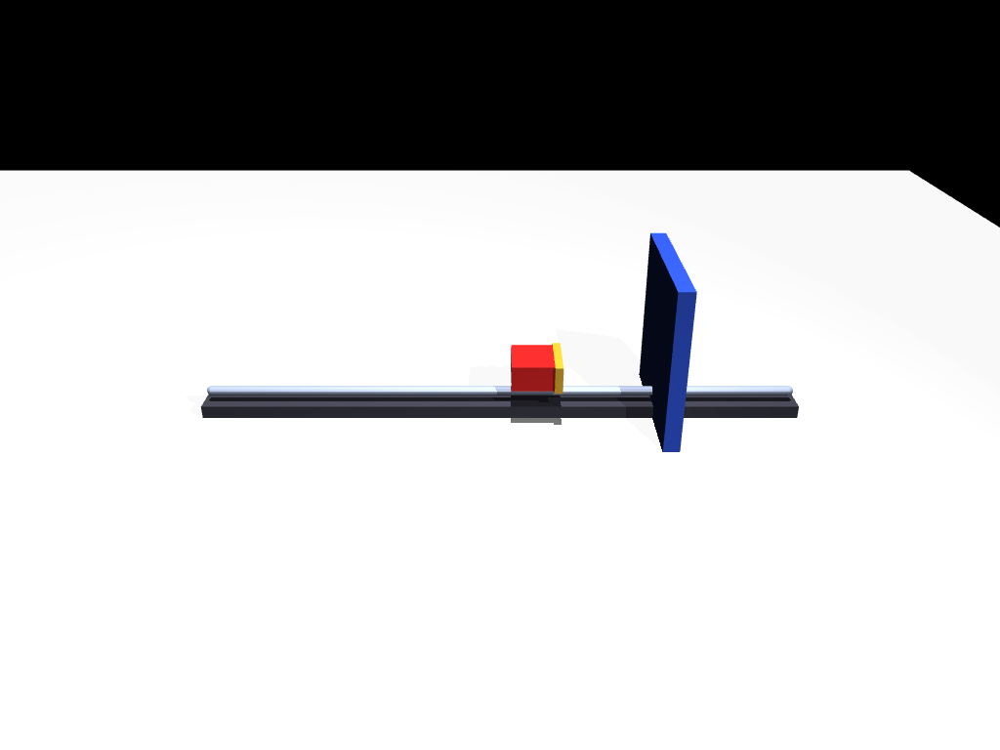
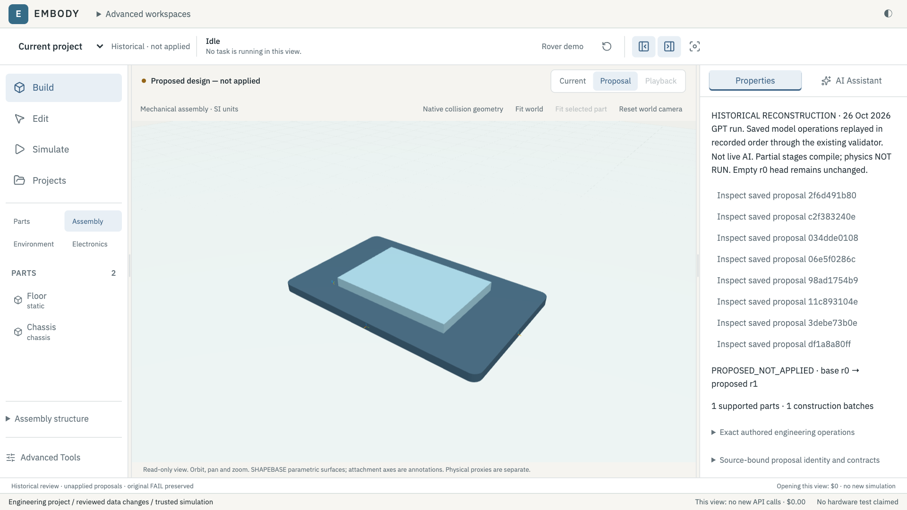
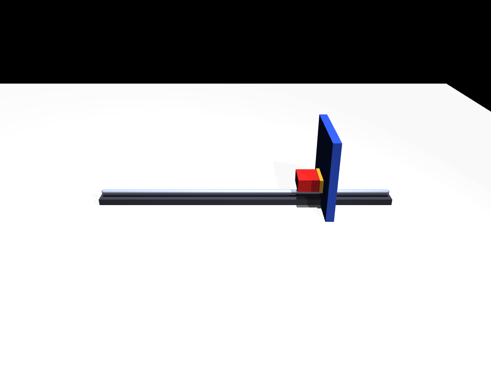
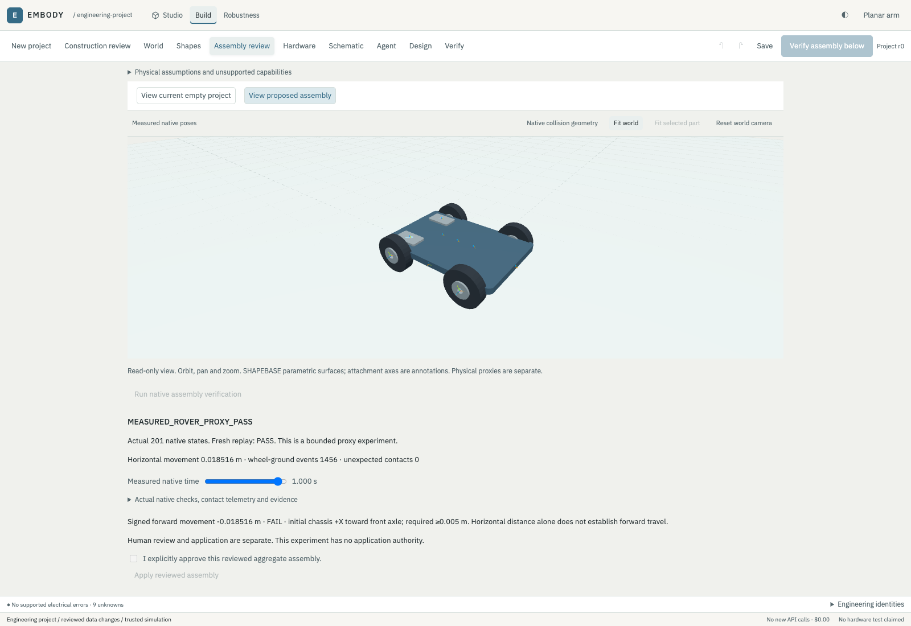
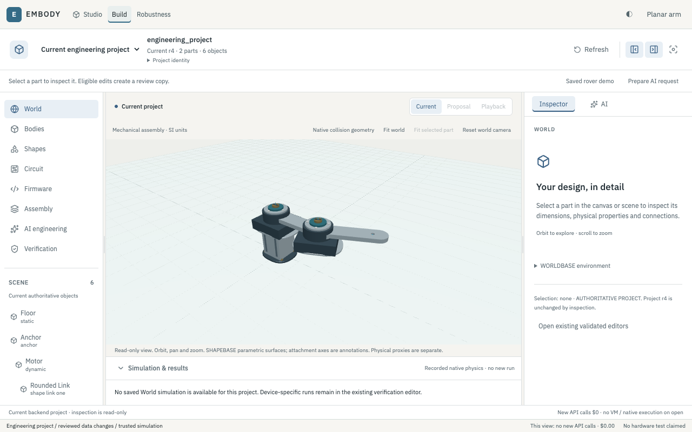
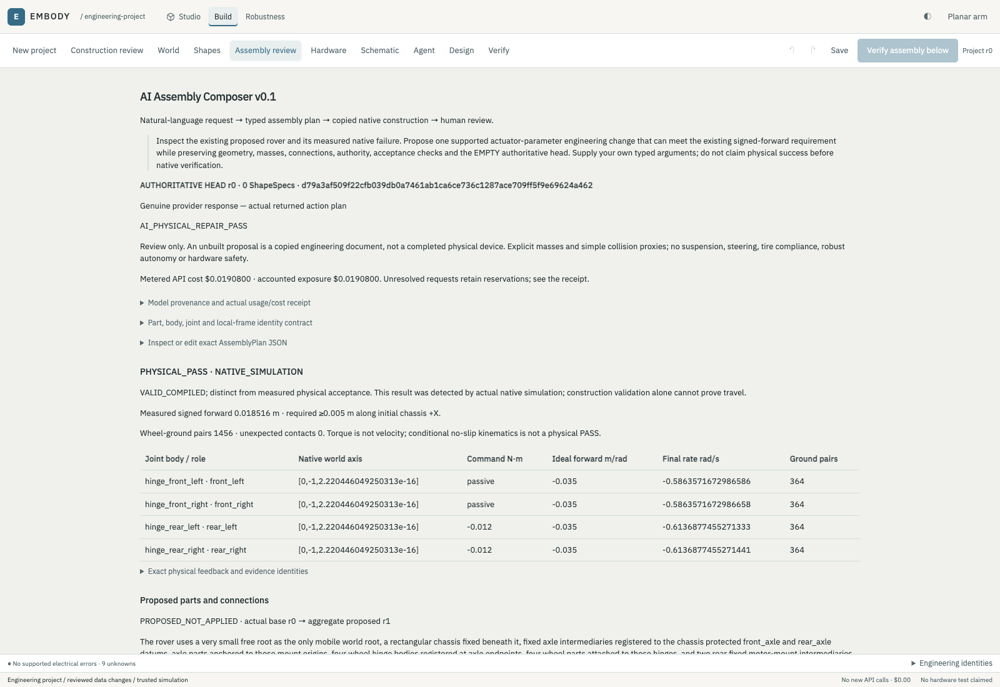

# Engineering development

These are conceptual technical milestones, not invented dates or elapsed-time claims. Original native renders and browser captures retain their real provenance. One later explanatory reconstruction is explicitly identified.

## Phase 1 — Engineering Foundations

Explicit mass, force, geometry, units and initial state made measured behavior reproducible. Native state, contact and actuator-force checks established a baseline before visual polish.

Original saved MuJoCo render of the carriage model; not an illustration.

## Phase 2 — Geometry & Mechanical Design

Typed part creation grew into explicit body ownership, parent/joint relationships, named frames and parametric regeneration. Geometry and mounting relationships are validated together instead of inferred from appearance.

Later explanatory reconstruction of a saved model-authored chassis prefix, using unchanged operations and the existing compiler. It is not an original live incremental-build screenshot. The authoritative head stays empty.

## Phase 3 — Physics & Verification

A deliberately unsafe braking controller supplied a reproducible contact failure. Analytical feasibility, compiled limits and actual dynamics were treated as separate questions.

Original saved native frame selected against the measured first-contact timestamp; no new simulation or recreated historical image.

## Phase 4 — AI Engineering

Models propose exact typed data through bounded tools. Validation feedback can support a model-authored revision, but a structurally valid plan can still fail physics.

Original browser capture: the rover passed the older horizontal proxy check but failed signed forward travel. The lower FAIL remains authoritative; the earlier PASS label does not establish direction.

## Phase 5 — Integrated Studio

The interface brought selection, properties, proposals and measured playback into a shared canvas. Simplification reduced navigation and exposed common workflows while keeping detailed engineering identities inspectable.

Original earlier browser capture, before the later navigation simplification. Compare the [current studio view](assets/product/studio-overview.png); this comparison makes no claim about elapsed development time.

## Phase 6 — Testing & Product Refinement

Wheel-axis direction, torque commands, contacts and signed motion supplied actionable failure feedback. A separate genuine model-authored command repair passed the same finite directional requirement.

Original separate repair experiment: measured forward travel, wheel-ground contact and fresh native replay. The earlier failure was preserved, and application remained a separate human decision.

[Reference-ramp evidence](assets/product/reference-ramp.png) tests another bounded fixture, not the same model-directed rover. [Verification](VERIFICATION.md) summarizes the measured comparison; [limitations](LIMITATIONS.md) prevent extrapolating it to general locomotion or hardware safety.
