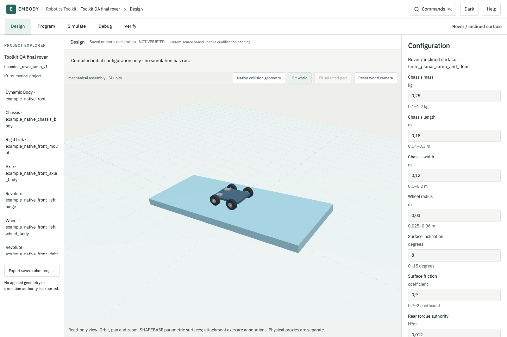
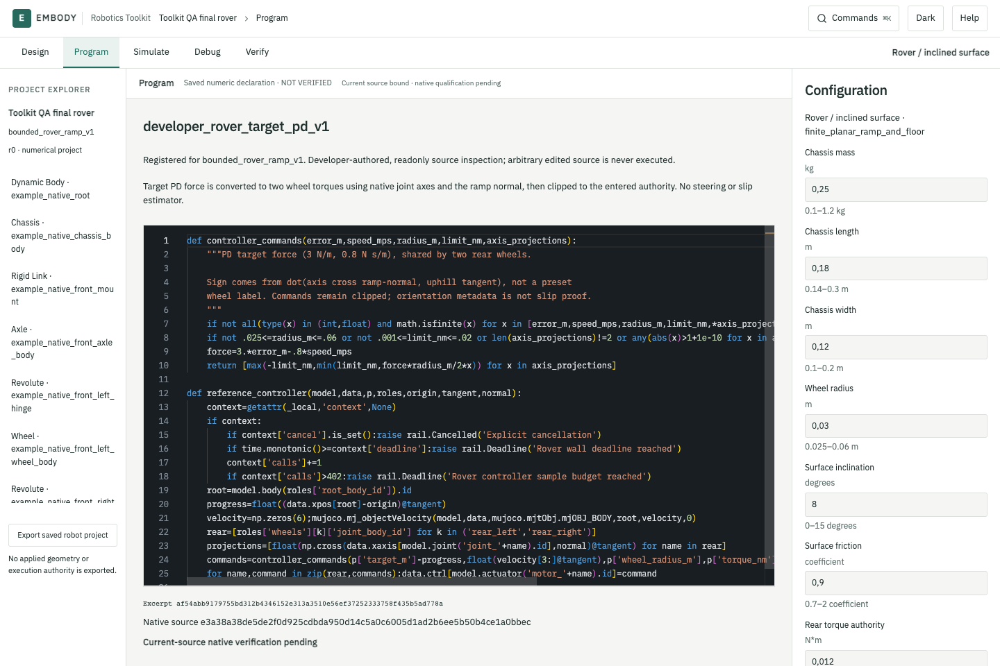
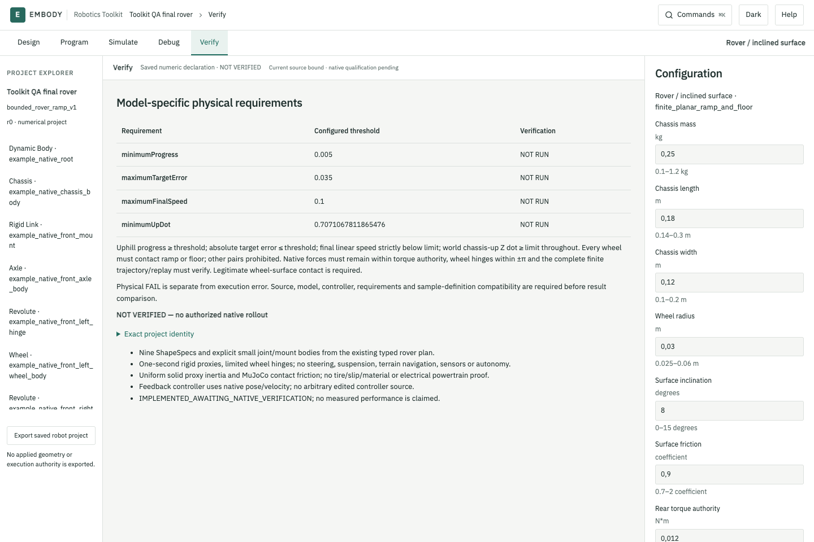

# Multi-model robotics toolkit · v0.8

The product has two fixed registered model implementations. A 3D model, valid JSON
or compiled proxy alone never establishes executable performance or physical PASS.
No new native integration, paid request, VM, installation or application is part
of this implementation. Current-source qualification needs fresh explicit approval.

| Capability | Rail carriage | Bounded rover/ramp |
|---|---|---|
| Model ID | `rail_carriage` | `bounded_rover_ramp_v1` |
| Native experiment | `rail_velocity_brake_v1` | `rover_ramp_target_v1` |
| Controller | `developer_velocity_brake_v1` | `developer_rover_target_pd_v1` |
| Native implementation | Existing registered reference, semantics preserved | New bounded implementation using existing typed rover/ramp/compiler |
| Current-source measured qualification | Pending; v0.6.2 saved data remain historical | Pending; no genuine new rover measurements |
| Editable context | Mass, initial speed, force, clearance | Chassis mass/length/width, wheel radius, slope, friction, torque authority, target |
| Analysis | Existing labelled ideal braking | No rail equations or claimed rover analytical performance |
| Playback | Four actual saved rail cases | Native pose/wheel/velocity/force replay implemented; no samples to display yet |
| Research | Existing compatible rail/adaptive engine preserved | Research's older ramp descriptor remains metadata-only; no research dispatch |

## Registration and execution

`ide_api/native_models.py` is a fixed two-module registry. Descriptors expose SI
fields/bounds, controllers, requirements, environment, source identity, trajectory
fields, policies, analysis and diagnostic support. Model IDs never select Python
modules, classes, functions, paths, URLs or executable source.

Both modules use the existing `RailSweeps` lifecycle: exact request validation,
shared nonce namespace, immutable request/case writes, retained-job limits,
cooperative deadline/cancellation, source recheck, replay and existing global
`Server.job` exclusion. The class name is retained for compatibility; no second
executor or arbitrary-model route exists. Product `/api/toolkit/` exposes only
read, numeric creation/save/import/export, compilation and preparation/inspection.
No toolkit approval, execute, apply or provider endpoint exists.

Changing registry/job/server code changes native source identities. Old rail
packages and source manifests are never rewritten; their source-current badge
remains false. Old consumed approvals and private VM certificates grant no new
native or untrusted-controller authority. Protected core/controllers/models and
qualification assertions are not modified.

## Rover construction, inputs and controller

The developer-authored `engineering.assembly_examples.rover_plan` builds nine
actual ShapeSpecs with explicit root, joint, axle and frame identities. Typed
`execute_copy`, unchanged structural checks, original RampService placement and
`world.compiler.compile_world` validate the model. There is one free root, four
limited ±π wheel hinges, passive front wheels and two bounded rear actuators.
The ramp is a fixed 1 × 0.4 × 0.04 m solid box over the original floor. Time step
is 0.005 s, horizon 1 s; 200 steps plus a fresh 200-step native replay per case.
Initial forward speed is zero; initial pose is the existing ramp-normal placement.

| Numeric field | Inclusive bounds | Meaning |
|---|---|---|
| chassis_mass_kg | 0.1–1.2 kg | Chassis proxy only; helpers, axles, wheels and plates add 0.142 kg |
| length_m | 0.14–0.30 m | Chassis length; axle centers remain at ±0.32 length |
| width_m | 0.10–0.20 m | Chassis width; existing axle/bore/frame relationships regenerate |
| wheel_radius_m | 0.025–0.06 m | Four equal solid collision cylinders; display bores omitted from inertia/contact |
| angle_deg | 0–15° | Ramp inclination, uphill tangent `(cos(angle),0,sin(angle))` |
| friction | 0.7–2 | Native ramp sliding coefficient; torsional/rolling values remain .005/.0001 |
| torque_nm | 0.001–0.02 N·m | Each rear motor's control/force limit, unit gear |
| target_m | 0.02–0.12 m | Signed final progress target relative to actual initial root position |

A coupled geometry predicate also requires `2 × wheel_radius_m ≤ 0.64 × length_m − 0.002 m`, leaving at least 2 mm between front/rear wheel envelopes. Larger wheels therefore require sufficient chassis length; invalid combinations reject rather than silently resizing another field.

The default moving mass is 0.292 kg, not just its 0.15 kg chassis input. The
compiler independently checks geometry, masses, uniform proxy inertia, joint
ranges and clipped scalar/generalized forces. Display SHAPEBASE profiles are
separate from native solid collision proxies. Friction follows actual MuJoCo
mixing; no tire/material calibration, slip detection or powertrain coupling.

The deterministic controller computes `F = 3 × target_error − 0.8 × tangent_speed`
(N, from native world pose/velocity). Each rear request is `F × radius / 2`, signed
by the native wheel-axis cross ramp-normal projection on uphill tangent, then
clipped to entered authority. It is a simple feedback reference, not an autonomy
or grade-compensation guarantee; gravity/contact may make some requested targets
unreachable or fail settling. No performance is claimed before measurement.
No steering, suspension, arbitrary terrain, continuous wheel travel or sensors.

## Requirements and evidence

Rover mandatory checks: signed progress ≥0.005 m; absolute target error ≤0.035 m;
final world linear speed strictly <0.10 m/s; minimum chassis-up/world-Z dot at
all samples ≥cos(π/4); every wheel observed contacting a supported ramp/floor;
no other contact pairs; actual motor forces within authority; all wheel angles
within ±π (1e−6 rad solver tolerance); complete finite 201-sample grid; fresh replay.
User thresholds may only tighten. These are finite sampled predicates, not a
continuous stability proof or real-world safety boundary. New rover predicates
are separate from unchanged historical flat-rover and RampService verdicts.

`model_evidence.py` verifies the explicit V2 rover package, exact current registered
source/controller/input/criteria/XML/construction, primary/replay hashes and equal
saved samples. Independent `mj_forward` readback checks actual geometry, root
velocity/orientation, wheel angles, controller requests, scalar/generalized forces
and contact pairs, then recomputes metrics/checks. This readback integrates zero
steps and cannot prove an external package's origin. External packages remain
`INTEGRITY_VALID_EXTERNAL_UNVERIFIED`; actual fresh replay must be performed during
authorized execution. No imported package becomes a local execution attestation.
Historical rail package reader and original v0.6.2 bytes are unchanged.

Model debugger dispatches progress, target error, speed, orientation, force,
contact and joint checks only after validated corresponding evidence. Missing
results remain UNVERIFIED. Torque shortage, tire slip or traction loss are not
proven causes merely because progress failed. Compatible comparison requires
same model/controller/source/criteria/simulation/measurement definition; changed
parameters are explicit. Rail evidence can never verify a rover declaration.

## Declarative import and project workflow

`EMBODY_ROBOT_PROJECT_V1` contains exactly format, title, registered model and
controller IDs, parameters and requirements. Limit 16 KiB, finite bounded numbers,
no extra fields/source/XML/file references, no unknown model/controller pair,
no weakened mandatory requirements. Duplicate JSON fields reject, including when
loaded through the actual file-import UI. Export contains only the declaration;
source bindings, runtime heads, evidence and authority are never exported.

Numerical model projects use existing content-addressed `Store` plus an atomic
exact-head pointer, finite retention (16 projects), explicit saves and source-stale
rejection. They are not applied World/robot heads. The v0.7 rail Research-plan
store remains readable and is not silently migrated. Explicit re-import creates
a new source-bound unverified project, not a relabelled old verification.

Design shows actual compiled initial geometry or an explicitly labelled prior
preview. Program is readonly registered code. Simulate prepares exact numeric
scope and displays approval pending; no execution action. Debug/Verify withhold
unmeasured verdicts. Existing rail saved workflow and model workspaces keep their
own exact contexts and reject stale asynchronous preparation. Old mechanical/
circuit studio remains independent; numeric import does not imply MCU execution.

## URDF / MJCF scope

Optional 32 KiB / 128-node / depth-12 inspection parses topology and primitive
geometry metadata only. DTD/entities, processing instructions, includes/file/asset
references and duplicate/broken/cyclic URDF parentage reject. Unsupported tags
are reported. No external filesystem or network assets are resolved. No imported
XML is compiled or assigned a registered native identity; it cannot simulate.
This is not general robot import/admission or a CAD kernel.

## Current-source qualification approval gates

Use the installed environment to prepare/check exact private manifests:

```sh
python -B -m tools.model_qualification prepare --model rail_carriage
python -B -m tools.model_qualification prepare --model bounded_rover_ramp_v1
python -B -m tools.model_qualification check --manifest <returned-private-relative-path>
```

These actions cannot execute or grant approval. Check exact canonical/byte hashes,
source closure, Git base, installed versions, descriptor, numbers, unchanged
criteria, unused nonce, expiry and retained-job capacity. Freeze is 48 hours; drift
or expiry requires new preparation and fresh explicit user approval, not extension.
The trusted local operator must record actual approval and acquire the existing
global job lock before invoking the exact approved request once. No browser
preparation, hash possession, CLI argument or old consent substitutes for approval.

Proposed rail regression: 4 kg, 1.2 m/s, 2 N at 1.440/1.490 m initial clearance;
2 cases, 4 rollouts, 2,400 steps. Proposed rover: level default configuration and
10°/0.6 kg chassis/0.003 N·m challenging configuration; 2 cases, 4 rollouts,
800 steps. **Separate approvals**, 600 seconds exclusive per scope, cooperative
60-second job deadline, zero retries/paid calls/VMs/installations/applications.
Total if both are separately approved: 4 new cases, 8 rollouts, 3,200 steps.
No outcome is predeclared. No 1.4775 m refinement is included or authorized.

## Genuine current application views

These are actual Chrome captures over an explicitly QA-created numeric rover
project. The model is compiled, not simulated or applied. No physical PASS is
presented; the displayed controller is registered developer code, not live AI.







The V2 backend comparator can validate two compatible rover results; a general
cross-configuration rover comparison UI is not added before genuine results
exist. The product currently loads only exact current-input results. Full robot
CAD/import, controller source execution and merged mechanical/circuit projects
remain outside this bounded toolkit.

At very early startup an import can receive a legitimate same-origin token
refusal before bootstrap finishes. Wait for the normal catalog/readiness state
and retry the local import; the server does not accept a missing token. This
remaining startup UX limitation does not grant execution or weaken authorization.
