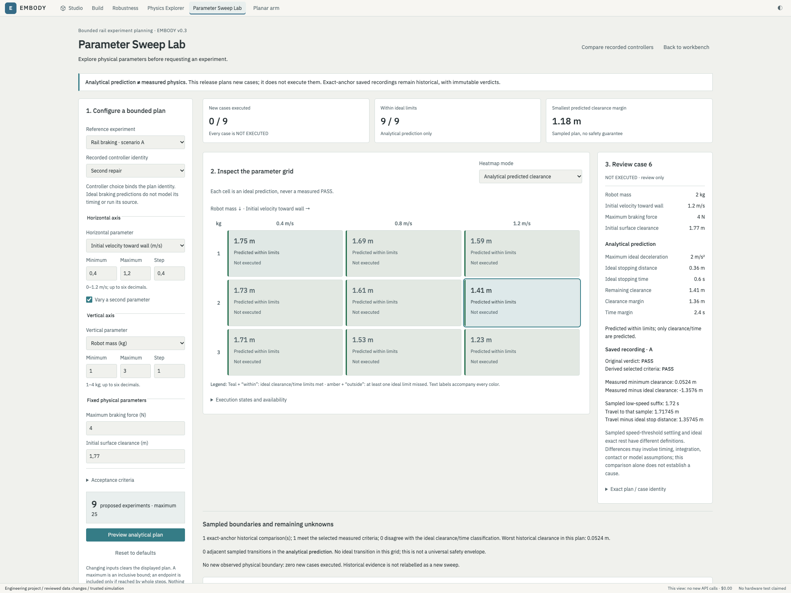
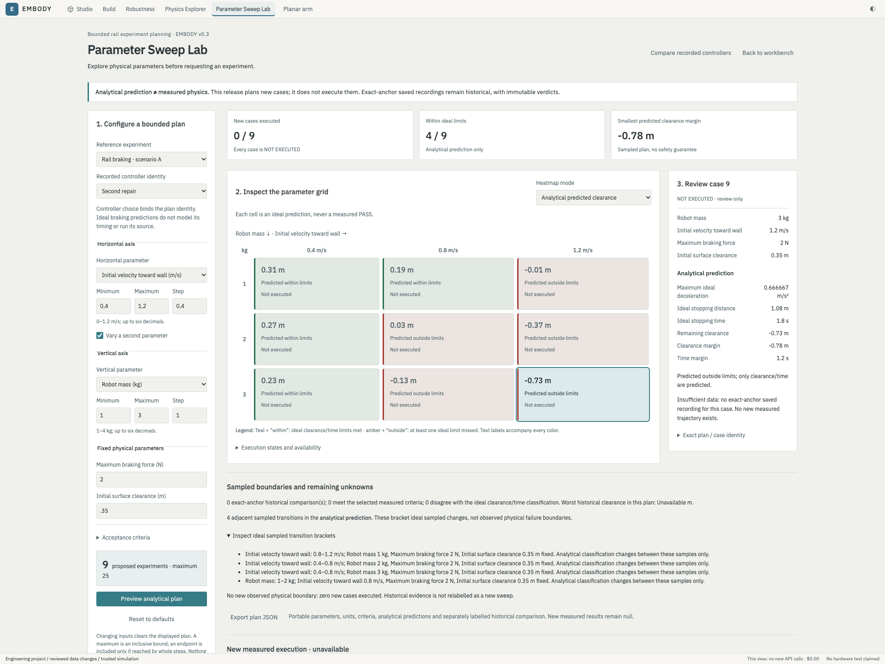

# Parameter Sweep Lab · v0.3

Plan bounded rail-braking experiments, inspect ideal braking predictions and
compare an exactly matching historical anchor. **New MuJoCo sweep execution is
unavailable in this release.** A predicted result never becomes a measured PASS.



Open **Simulate → Open Parameter Sweep Lab**, **Advanced workspaces → Parameter
Sweep Lab**, or **Plan a parameter sweep** inside Physics Regression Explorer.
Back to workbench preserves the current project. These views use only existing
read-only experiment requests; no new backend endpoint or execution tool exists.

1. Select rail scenario A, B or C as the geometry/context anchor, then a recorded
   controller identity. Controller selection binds provenance; it does not make
   the ideal model reproduce that controller's behavior.
2. Choose one or two distinct parameters, enter minimum/maximum/positive step,
   set the remaining fixed values, and optionally adjust acceptance criteria.
3. Check the proposed count, then explicitly select **Preview analytical plan**.
   Changing inputs clears the old preview. No edit or preview starts physics.
4. Select a heatmap cell to inspect parameters, predictions, margins and any
   exact-anchor saved recording. Switch heatmap modes to inspect historical
   clearance or derived acceptance over saved measurements.
5. Use **Export plan JSON** for a portable review document. It is not execution
   permission or an applied project. Compare recorded controllers opens the
   existing Regression Explorer.

## Parameters and reproducible grids

| Parameter | Inclusive planning bounds | Existing physical mapping |
|---|---|---|
| Robot mass | 1–4 kg | BODYBASE mass; native template scales declared inertia with mass |
| Initial velocity toward wall | 0–1.2 m/s | WORLDBASE initial velocity; BODYBASE initial-speed ceiling |
| Maximum braking force | 2–6 N | BODYBASE direct motor control/force ranges, gear 1 |
| Initial surface clearance | 0.35–2.2 m | Wall near face minus initial bumper front; move wall center with its size fixed |

Mass, force and gap bounds follow the existing bounded rail parameter envelope.
Zero velocity is a stationary analytical case; values below 0.4 m/s are outside
the historical robustness sampler's speed range. No new measured coverage is
implied. Initial position, geometry, timestep, duration and gravity stay bound to
the selected anchor and are not sweep controls. SHAPEBASE geometry is not changed.

Maximum grid size is **25**, including a 5×5 grid; code may select a stricter cap
from 1–25 but cannot raise the policy ceiling. Inputs are finite and bounded,
with at most six decimal places. Integer micro-unit steps prevent accumulated
floating-point duplicates. The upper bound is inclusive, but is included only
when reachable by whole steps. A zero-width range produces one value. Horizontal
values vary fastest; vertical values form rows. Stable case IDs bind the rail
planning version, anchor, exact controller SHA-256 and all four parameter values;
the plan separately carries the exact recording inventory and numerical context.

The default nine-case plan uses masses 1/2/3 kg, speeds 0.4/0.8/1.2 m/s, force
4 N and initial surface gap 1.77 m. Its **analytical remaining clearance**, m:

| Mass ↓ / speed → | 0.4 m/s | 0.8 m/s | 1.2 m/s |
|---|---:|---:|---:|
| 1 kg | 1.75 | 1.69 | 1.59 |
| 2 kg | 1.73 | 1.61 | 1.41 |
| 3 kg | 1.71 | 1.53 | 1.23 |

All nine meet the default **ideal clearance/time** limits; the smallest predicted
clearance margin is 1.18 m. **Zero new cases have executed.** This is not nine
measured passes and does not predict the selected controller's timing.

## Analytical prediction and measured definitions

The ideal model is constant maximum braking starting immediately at t=0 and
ending at rest, with one-dimensional motion and no control delay:

```text
a_max = F / m                     [m/s²]
d_stop = m × v² / (2 × F)          [m]
t_stop = m × v / F                [s]
remaining clearance = initial surface gap − d_stop
clearance margin = remaining clearance − selected minimum clearance
```

The ideal classification checks only remaining clearance and ideal stopping time.
Both are inclusive with the existing 1e−12 clearance/time tolerance. The recorded
speed/contact criteria are not new analytical predictions. Existing shared
criterion validation and saved-run evaluation retain their strict speed limit,
contact episodes, missing-data rules and sampled settling definition.

At 2 kg, 1.2 m/s, 4 N and gap 1.77 m, a = 2 m/s², ideal d = 0.36 m,
ideal t = 0.6 s and remaining gap = 1.41 m. The matching second-repair A recording
has measured minimum clearance approximately 0.0524 m. The signed difference,
measured minimum minus ideal remaining gap, is approximately −1.3576 m. The
original controller at the same anchor remains recorded FAIL despite the ideal
classification. Immediate maximal braking is an assumption, not an explanation
of the actual controller's behavior.

Measured travel to settling uses the first saved position and the first sample
whose entire remaining speed suffix stays below the selected speed limit. It is
unavailable when settling or positions are missing. This is **not exact zero-speed
stopping distance**. Its difference from ideal distance is descriptive; the
underlying definitions differ. Timing, integration, contacts and assumptions can
contribute to discrepancies, but the comparison alone proves no specific cause.

## Historical comparison and failure boundaries

Only a case matching all four parameters of the **selected anchor and controller**
can attach that anchor's saved recording. Matching other scenarios is deliberately
not inferred from superficially similar parameter values. The existing reader
verifies the immutable recording inventory, and the planner checks consistent
initial context/geometry. All other cases show unavailable measurements.

Historical minimum clearance, immutable verdict, derived selected-criteria result
and actual trajectory are labelled as saved evidence. New case execution remains
NOT EXECUTED and new measured results stay null, even where a historical
comparison exists. Read errors block loading; no fallback study is substituted.

Heatmap colors always have accompanying text. Its three modes are analytical
predicted clearance, historical measured minimum clearance and historical derived
acceptance. Status documentation distinguishes planned/predicted/not-executed,
running, measured PASS/FAIL, execution error and insufficient data. This release
cannot enter new running/measured/error execution states because it has no runner.

For example, keeping the default mass/speed grid but using 2 N and a 0.35 m gap
produces four cases within ideal clearance/time limits and five outside. The worst
predicted remaining gap is −0.73 m, with a −0.78 m clearance margin. Negative ideal
clearance indicates insufficient ideal stopping space, not a simulated penetration.
Adjacent classification changes are listed as **analytical sampled brackets**,
not observed physical failure boundaries. No new observed boundary is claimed.



## Why execution is unavailable

The audited low-level [rail runner](../core/simulation.py) accepts Python controller
callbacks. It is not a bounded numeric/controller-allowlist API. Existing repaired
rail [evaluation](../robustness/evaluator.py) calls source/model qualification and
requires the VM backend for first rollout and fresh verification. Existing
[reference controllers](../core/robots/reference.py) operate the planar arm, not
the rail. World/device simulation routes use different contracts and may commit
project evidence; they cannot substitute for this review-only rail planner.

No host import of recorded model-authored controller source, alternate execution
route, VM launch, certificate change or protected-source change was introduced.
Before measured rail sweeps can be enabled, a separate review must define an
allowlisted trusted reference-controller route, numeric admission, serial case
budgets, independent native verification, preserved error/failure outputs and
append-only experiment storage outside examples. Any necessary qualification-bound
changes or VM execution require their own review and explicit authorization.

## Export and limits

The explicit browser JSON download uses `EMBODY_RAIL_SWEEP_PLAN_V1`: stable case
IDs, parameter/criterion units, selected controller/inventory identities, public
numerical context, axes, criteria, ideal predictions, NOT_EXECUTED status and null
new measurements. An optional `historical_comparison` is explicitly tagged
`REUSED_SAVED_RECORDING_NOT_NEW_EXECUTION`. Arbitrary backend metadata, paths,
provider prompts, credentials and certificates are excluded. Nothing is written
into reference-study directories or authoritative project heads.

These bounded mathematical predictions and finite historical recordings do not
prove real material/contact fidelity, manufacturing feasibility, controller
robustness outside recorded cases or real-world safety. No general geometry
sweep, arbitrary code execution, live AI generation or new simulator result is
included. CSV export and live execution are not implemented.

Focused checks, without backend changes or a broad historical regression:

```sh
npm --prefix frontend test -- src/parameterSweep.test.ts src/ParameterSweepLab.test.tsx src/physicsRegression.test.ts src/PhysicsRegressionExplorer.test.tsx src/App.test.tsx src/PhysicsPanel.test.tsx src/UnifiedWorkspace.test.tsx src/playback.test.ts
npm --prefix frontend run typecheck
npm --prefix frontend run build
```
