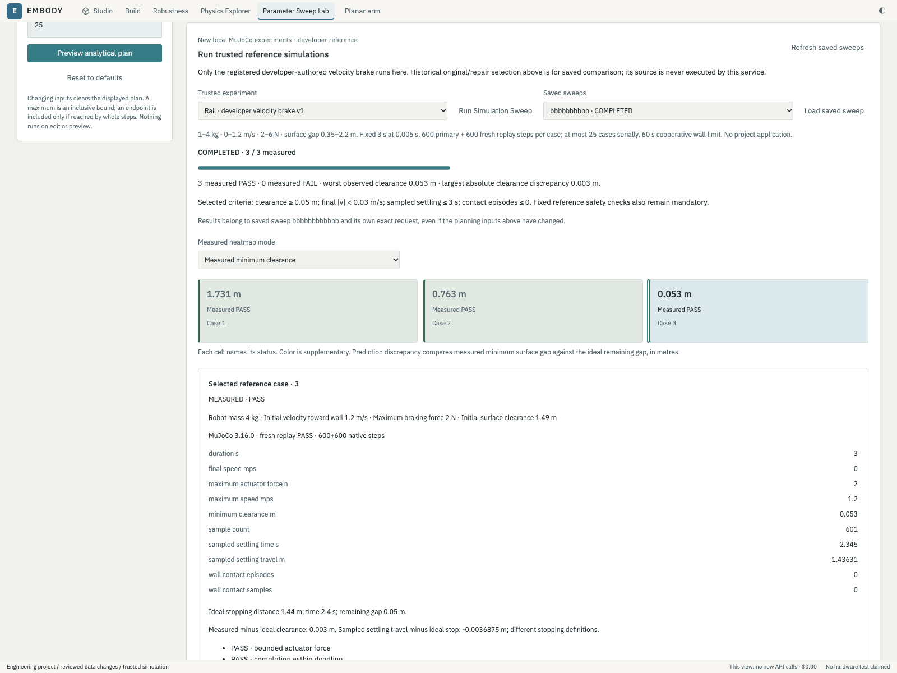
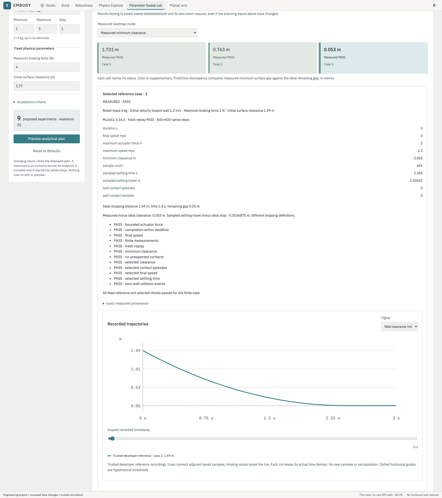

# Parameter Sweep Lab · v0.4

Configure bounded rail experiments, compare ideal predictions, then explicitly run
**only the registered developer-authored velocity brake** through the trusted local
MuJoCo service. Historical original/repair controller source is never executed by
this route. Analytical preview and saved historical comparisons remain independent.

Open **Simulate → Open Parameter Sweep Lab**, **Advanced workspaces → Parameter
Sweep Lab**, or **Plan a parameter sweep** in Physics Regression Explorer.

## Configure, review, explicitly run

1. Select an A/B/C numerical/geometry anchor, one or two distinct parameter axes,
   minimum/maximum/positive step and fixed values. Preview the analytical plan.
2. Inspect the count and heatmap. A maximum is an inclusive bound, included only
   if whole steps reach it. Integer micro-unit stepping prevents accumulated
   floating-point duplicates; up to six decimals and 25 cases are supported.
3. In **Run trusted reference simulations**, review the registered developer
   controller and choose **Run Simulation Sweep**. Confirm the exact case/step
   bounds. Historical controller selection above remains saved-comparison context;
   the new request binds a different controller/source identity.
4. Follow per-case states, inspect measured cells, or request cancellation.
   Cancellation is cooperative between fixed native steps; completed cases remain.
   Interrupted/failed requests never retry automatically. Refresh saved sweeps to
   recover an uncertain admission, then explicitly load its existing record.
5. Select a measured case for actual trajectories, metrics, criteria, model/source
   hashes and fresh replay. Export its sweep explicitly as portable JSON.

Changes to planning inputs clear its analytical preview but do not relabel a prior
measured request. Run is disabled without a valid preview or while a known job is
active. No model call, simulation or project application occurs on load/edit/export.
Back to workbench preserves the authoritative project.

## Supported physical parameters

| Parameter | Inclusive range | Fixed model mapping |
|---|---|---|
| Robot mass | 1–4 kg | BODYBASE declared moving mass and proportional template inertia |
| Initial velocity toward wall | 0–1.2 m/s | WORLDBASE initial velocity; BODYBASE initial-speed ceiling |
| Maximum braking force | 2–6 N | Direct gear-1 motor control and force limits |
| Initial surface clearance | 0.35–2.2 m | Wall near face minus initial bumper front; fixed wall size |

Initial position is fixed at 0 m; bumper front starts at 0.18 m. The wall center is
`0.18 + gap + 0.05` m. Geometry, vertical gravity, 3-second horizon and 0.005-second
timestep are not browser-supplied sweep fields. Zero velocity is stationary; it
extends below the historical robustness sampler's 0.4 m/s floor without claiming
historical coverage. No arbitrary robot/SHAPEBASE geometry, controller, XML or file
path can enter this execution route.

The analytical model remains `a=F/m`, `d=mv²/(2F)`, `t=mv/F`, remaining clearance
`gap−d`. It assumes immediate constant maximum braking to exact rest, no control
delay, contact effects or numerical integration. It predicts ideal clearance/time
only; it is never measured physics or the behavior of a selected historical repair.

## Trusted execution and authorization

The only registered experiment is `rail_velocity_brake_v1`, controller
`developer_velocity_brake_v1`. Its new developer source applies force opposing
current velocity from t=0, bounded by the compiled actuator range, clipping the
last command to avoid a commanded reversal. It has no wall-proximity trigger and
is not a model-authored repair. See [service and controller](../ide_api/rail_sweeps.py).

The service reuses unchanged [BODYBASE](../core/bodybase.py),
[WORLDBASE](../core/worldbase.py), [compiler/runner](../core/simulation.py), fixed
[rail template](../robot/rail_carriage.xml) and [original acceptance](../core/diagnostics.py).
A separate fresh MjModel/MjData replay directly steps the same registered controller
and independently measures state, forces, geometry with `mj_geomDistance` and
contact IDs. It is independent execution with shared MuJoCo/controller, not a
second physics engine or formal proof. The historical faulty-controller verifier
and VM candidate route remain unchanged.

| Bound | Enforced policy |
|---|---|
| Cases | 1–25, validated server-side; serial |
| Integration | 600 primary + 600 fresh replay steps per case; maximum 30,000 |
| Samples | 601 per primary/replay trajectory |
| Horizon | 3 s, timestep 0.005 s |
| Deadline | 60 s per sweep, cooperatively checked between fixed native steps |
| Storage | At most 16 retained local sweep directories; no automatic deletion |
| Request | Exact schema, at most 16,384 bytes, inside the existing bounded JSON API |
| Responses | Overview ≤65,536 bytes; each full case ≤1,500,000 bytes |

The service adds existing-style routes to the loopback API:

- GET `rail-sweeps/catalog`, `rail-sweeps/state?id=…`, `rail-sweeps/case?id=…&case=…`
- POST `rail-sweeps/start` and `rail-sweeps/cancel`

Writes retain the existing Host/Origin/Sec-Fetch-Site/CSRF/content-type/size guards
and shared single-expensive-job lock. Requests allow only fixed experiment and
controller IDs, current source identity, numerical cases/criteria, finite nonce and
explicit confirmation. Supplied code, imports, executable/model/output paths,
external XML and historical repairs reject before dispatch. No shell, arbitrary
module loader or VM bypass is introduced. The source identity binds the controller/
service, API adapter, model, contexts, numerical engine versions and execution
policy; source drift blocks admission and subsequent cases. Duplicate nonces never
resubmit; mismatched reuse rejects. This is a single-operator local workflow, not
an authenticated remote multi-user service or a sandbox for untrusted programs.

No protected VM/core/physics/configuration identity, qualification protocol,
baseline, certificate or historical evidence is changed. This trusted developer
route grants no authority to execute model/user source. Other installations and
candidate execution still require their existing qualification and approval.

## Measured acceptance and interpretation

A measured PASS requires **all original fixed rail checks**, selected criteria,
force/contact audit and fresh replay. Lowering a selected threshold cannot weaken
the original minimum 0.05 m clearance, final speed strictly below 0.03 m/s, zero
wall contacts, complete 3-second horizon and finite measurements.

Selected native criteria are bounded to clearance 0–2.2 m, positive final-speed
limit ≤1.2 m/s, settling deadline 0–3 s and integer contact limit 0–600. The planner
may express other hypothetical criteria, but the native service rejects unsupported
ones before execution. Clearance/time comparisons use the existing 1e−12 tolerance;
final speed is strictly exclusive. Sampled settling is the earliest saved sample
whose entire remaining speed suffix stays below the selected limit. Its travel
from the initial sample is **not exact continuous stopping distance**.

Measured views show minimum clearance, final/peak speed, force peak, wall-contact
episodes and samples, sampled settling, duration and 601-point trajectories. Modes
include clearance, final speed, acceptance and signed measured-minus-ideal clearance.
Sparse grids show unavailable combinations; requests varying more than two fields
use case cards. Execution errors and cancelled/unexecuted cases never become PASS.
A delayed case read withholds the previous case's trajectory rather than showing it
under a newly selected identity.

Boundary summaries use adjacent measured PASS/FAIL cases with all other parameters
fixed. Unexecuted/error gaps do not establish transitions. An analytical bracket
is separate from an observed physical boundary; neither is a universal safety envelope.

## Genuine bounded demonstration

The development demonstration used **three distinct cases and three fresh replays**:
six actual native rollouts, 3,600 total integration steps. No later browser test
started native physics. Each case completed the fixed/selected checks and replay.

| Case | Mass kg | Speed m/s | Force N | Initial gap m | Ideal stop m | Ideal remaining gap m | Measured minimum gap m | Final speed m/s | Contacts | Verdict |
|---|---:|---:|---:|---:|---:|---:|---:|---:|---:|---|
| Ordinary | 2 | 0.4 | 4 | 1.77 | 0.04 | 1.73 | 1.731 | 0 | 0 | PASS |
| Heavier / higher speed | 4 | 1.2 | 2 | 2.20 | 1.44 | 0.76 | 0.763 | 0 | 0 | PASS |
| Near limit / challenge | 4 | 1.2 | 2 | 1.49 | 1.44 | 0.05 | 0.053 | 0 | 0 | PASS |

Measured-minus-ideal gap differences were approximately +0.001/+0.003/+0.003 m.
There was **no measured failure or observed PASS/FAIL boundary** in this small
sample. The outcome was not forced. Saved state readback can assess numerical
integration differences; generic timing/contact explanations are not assumed.
Fresh replay matched state/force/geometry within its recorded tolerance. Full
new user archives remain ignored local runtime data rather than Git fixtures.

## Persistence, exports and limits

New requests/states/results live under ignored `.runtime/rail_sweeps/`, outside
historical examples and authoritative projects. Request and case files are
write-once; bounded progress state is replaced atomically. Restarted in-flight
scopes are reported INTERRUPTED and never auto-resumed. Case readers verify saved
result, model and trajectory hashes. No browser-supplied output path exists.

The existing `EMBODY_RAIL_SWEEP_PLAN_V1` download remains an analytical/historical
plan: new measurements are null and its historical-controller execution flag is
false. The distinct `EMBODY_TRUSTED_RAIL_SWEEP_V1` export contains the exact new
request, status, actual measured cases/trajectories/replays, criteria, identities,
engine version and limitations. No private paths, credentials, raw prompts or
certificates are included. Export performs GET reads only.

Both actual measurements and predictions are finite rigid-proxy evidence, not
real-world safety, calibrated contact/material behavior, manufacturing proof or
arbitrary-controller robustness. Desktop macOS with existing MuJoCo dependencies
was exercised; no new OS/dependency installation qualification is claimed. The
wall timeout is cooperative, not OS process preemption. Local storage quota needs
explicit operator preservation/export/maintenance when full. No paid model call,
new VM, automatic application or broad historical suite is part of this feature.

## Reviewed Designer transfers

[AI Experiment Designer](AI_EXPERIMENT_DESIGNER.md) can transfer an exact current,
human-reviewed developer-reference plan. Sweep Lab rechecks its review/source,
shows its actual registered controller/context and keeps configuration read-only;
return to the Designer to edit/review. The existing native confirmation remains
mandatory, and native admission independently validates every request. A source
mismatch disables the reviewed run control; it is never silently rebound.

Reference exports use `EMBODY_REVIEWED_REFERENCE_PLAN_V1`, with designer context
and trusted source identities. They are not historical recording inventories.
Preview cards are not native execution accounting: inspect the separate saved
native job and explicitly link it in the Designer to associate actual execution.
The v0.5 verification read existing v0.4 results only; its consumed native budget
was not reused. The API adapter source changes, so old records retain their exact
old identity and are labelled stale relative to current execution.
