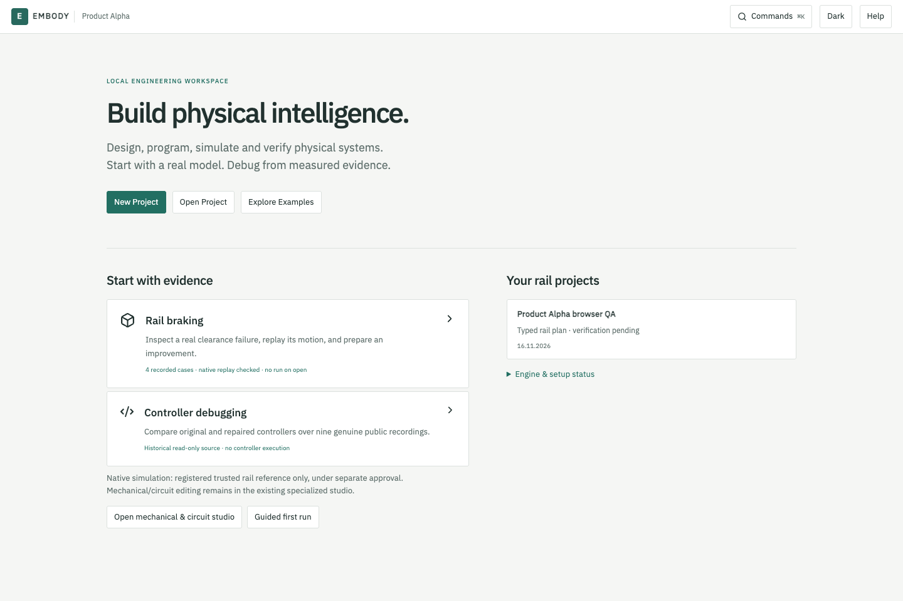
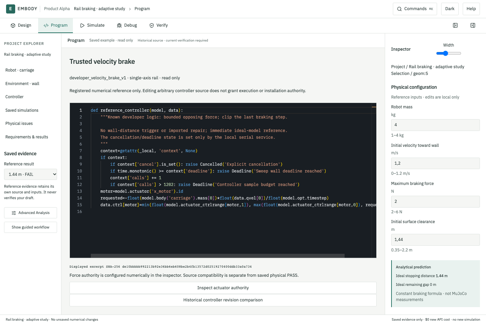
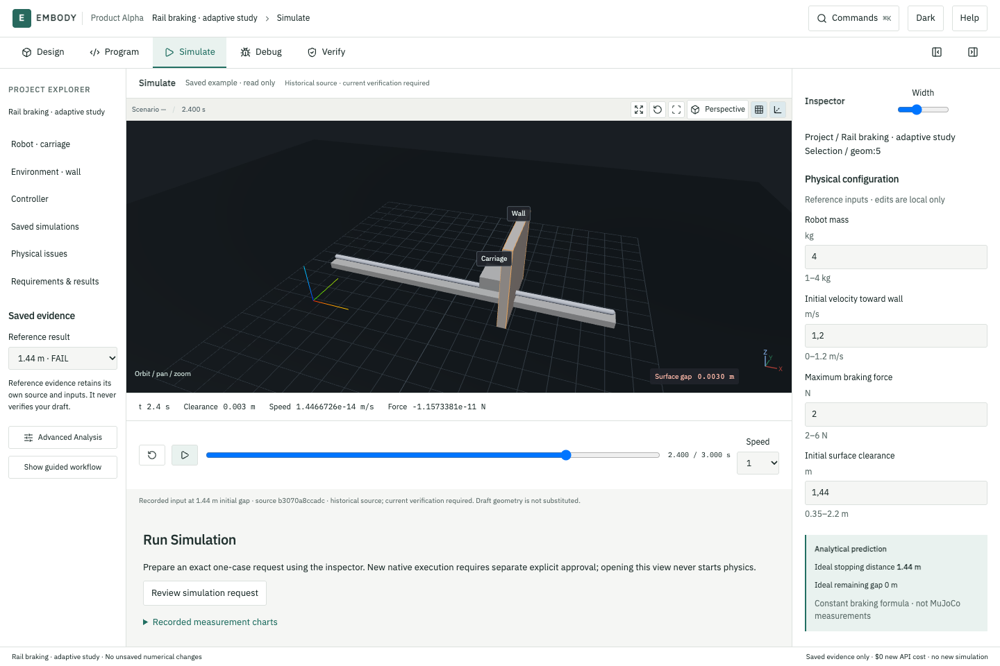
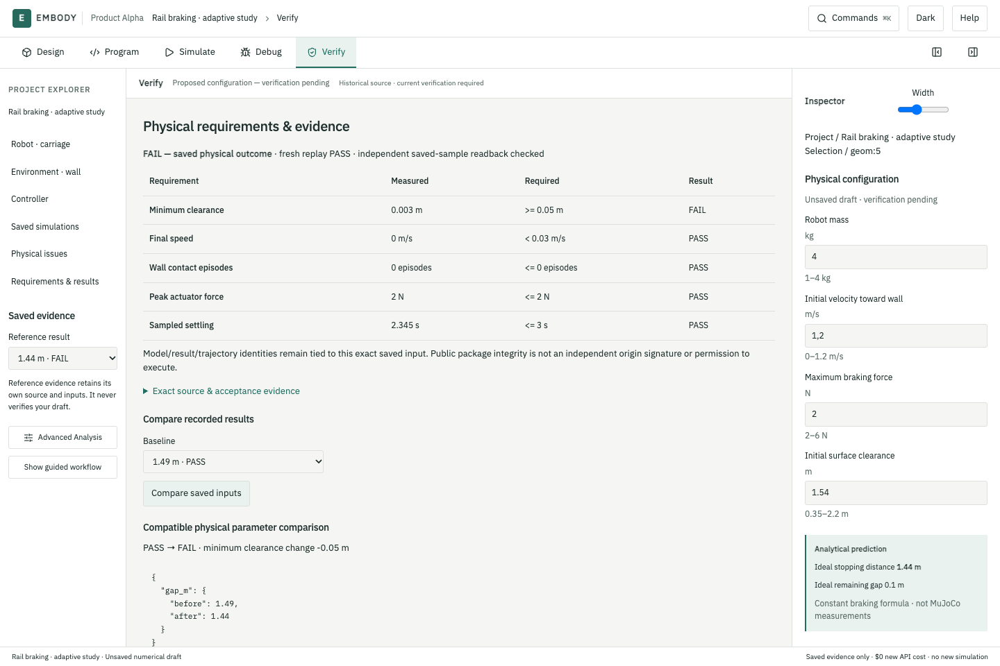

# Product Alpha — registered multi-model foundation

## v0.8 current implementation

The default product now includes a registered rover/ramp numeric project alongside
the preserved rail workflow. See the [multi-model toolkit guide](MULTI_MODEL_TOOLKIT.md)
for exact editable parameters, controllers, requirement meanings, import/export,
source compatibility and native qualification gates. Rover geometry compiles
through the actual typed engine; there are no new measured rover results. New
rail/rover native verification is pending separate explicit approval. Existing
applied mechanical heads and prior rail-plan snapshots are not migrated.

## v0.7 preserved baseline and remaining boundaries

The default product entry is Home, followed by Design / Program / Simulate /
Debug / Verify. The completed scope is a focused, functional rail engineering
journey, not an unrestricted robotics IDE or a completed all-model Product Alpha.

| Area | Implemented scope | Limitation |
|---|---|---|
| Home | Real example entries, actual recent rail projects, continue action, setup status, local guide | No cloud/account/project filesystem browser |
| Projects | Existing typed Research project/campaign persistence, exact-head explicit saves, bounded retention | Numerical rail plans, not applied World assemblies; rename/duplicate not implemented |
| Design | Saved native geometry, actual object selection, units/bounds, numerical drafts, ideal predictions | Draft mass/clearance is not regenerated or presented as measured geometry; SHAPEBASE remains a separate existing editor |
| Program | Actual trusted controller excerpt in read-only Monaco; numeric actuator authority | No arbitrary editable controller execution/installation |
| Simulate | Real saved playback and synchronized measurement cursor; strict one-case request preparation | No execution/approval/apply route in Product Alpha; separate authorization required |
| Debug | Five measured requirement checks, deficits, four-layer deterministic explanation, supported change preparation | No general root-cause solver, live AI or invented missing measurement |
| Verify | Exact saved acceptance/replay/source identities, compatible physical-parameter comparison | A saved PASS never verifies the draft or modified application |
| Adaptive | Existing selector over genuine compatible saved records, recorded 50→25 mm study | No new point runs; next 1.4775 m unapproved; 5 mm target unmet |
| Advanced | Existing mechanical/circuit/AI-review/regression/sweep/Research interfaces retained | Mechanical and rail project models are independent, not silently merged |
| Setup/guide | Existing readiness endpoint, offline repeatable five-step guide, Help and actual shortcuts | No installer, account, cloud service or usability-study claim |

## Shared context and persistence

One ProductAlpha component owns the active rail project/head, selected saved case,
viewport selection, active engineering view, numerical draft, playback cursor and
pending preparation. Switching views does not change those identities. Request
sequence guards withhold stale case reads. Exact context guards withhold late
preparation/comparison responses after a project/result/draft switch. Explicit
named saves use the existing exact expected-head predicate.

Projects reuse `Research.new`, `campaign`, `read` and `listing` under an isolated
Product Alpha namespace. No parallel geometry mutation engine or automatic build
is added. A saved campaign is a persisted numerical plan, not a measured or applied
robot revision. Existing engineering heads are untouched. Retention and snapshot
validation remain the existing contracts; quotas refuse rather than prune.

Original specialized App stays mounted after first open so its own selections and
drafts survive returning to rail views. Visibility propagation pauses hidden rail,
arm and engineering playback/rendering. Source and data identity do not cross the
two project domains. Controller debugging opens the actual existing public
Physics Regression Explorer; unavailable private studies remain unavailable.

## Physical Debugger

Strict public packages are pinned by exact byte hashes and checked through the
existing exporter/reader format, native saved replay check and sample arithmetic.
No import creates a local attestation. The product reports publisher-native origin
and external integrity verification separately. Known changed bytes are withheld.

Diagnosis uses the actual record's criteria and metrics: minimum clearance,
strict final-speed limit, contact episodes, peak actuator-force bound and sampled
settling deadline. Unknown/nonfinite/boolean measurements remain UNAVAILABLE;
execution/data absence is not physical FAIL. The selected exact native acceptance
check dictionary remains inspectable. Numerical issue verification is not a
universal diagnosis or proof of a hypothetical cause.

Observation names recorded samples. Interpretation explains what the failed
requirement means. Hypothesis is explicitly the ideal braking relationship,
not a proven cause. Action prepares bounded numbers for review. New values are
labelled verification pending, even if they match another recorded passing case.
The comparison endpoint requires the same complete compatibility contract and
preserves each input/result identity.

## Native and security boundary

Product routes add no execute/approve/apply/provider operation. Preparation calls
the existing strict native request validator without job admission, reservation,
rollout, retry or approval. Existing Host/Origin/CSRF, body bounds and global native
job admission remain unchanged. User input supplies no source, XML, module, file
path or controller implementation. Compiling pinned saved XML and `mj_forward`
for kinematics are not native integration or a new physical verification.

Adding routes to non-protected `ide_api/server.py` changes the native source
identity. Previous measurements retain their frozen original digest and display
historical-source/current-verification-required status. Original manifests,
consents, certificates, projects and native results are not migrated, relabelled
or requalified. A future new execution needs a new exact current-source scope.
No paid request, integration rollout, VM, dependency installation or controller
application is part of this implementation.

## Extension points

A future controller/model adapter must use the existing descriptor, numeric
validation, finite approval and independent evidence contracts. Future authorized
AI should supply a typed proposal to those validators, never bypass them. Product
context can supply project/selection/result identities after separate exact user
approval; no provider integration is added now. v0.8 work is described in the
[roadmap](PRODUCT_ROADMAP.md), not implemented here.

The product response recomputes `source_current` against the present native
catalog instead of copying an old capture's formerly-current badge. Original
package metadata remains immutable. The v0.6.2 example's documented full-source
comparison intentionally no longer passes on this modified server: that gate
checks the recorded execution version. Strict package integrity/replay/sample
arithmetic still verifies the saved historical data; it does not establish
current-source verification. No reader assertion is removed or relaxed.

## Actual product views

The Recent projects entry is the explicitly QA-created numerical plan; it is not
an original user robot head, applied assembly or model-generated construction.

The rail revision displayed in identity details is the derived count of persisted
project events; its authoritative identity is the exact immutable snapshot SHA.
It is not an applied World/robot revision. Generic legacy trajectory chart wording
still calls guides hypothetical; in this product view their values are supplied
from the selected record's frozen criteria. No measurement or threshold is changed.
