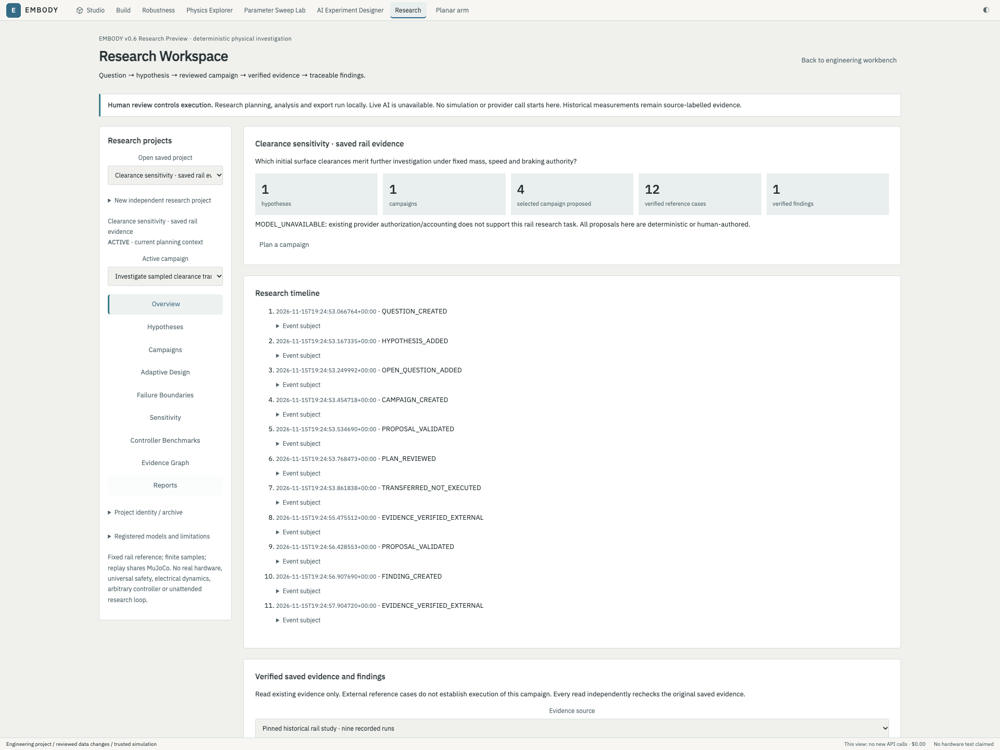
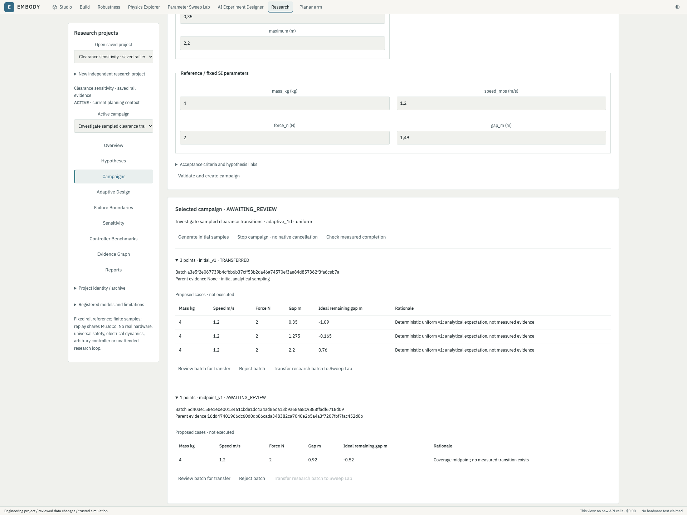
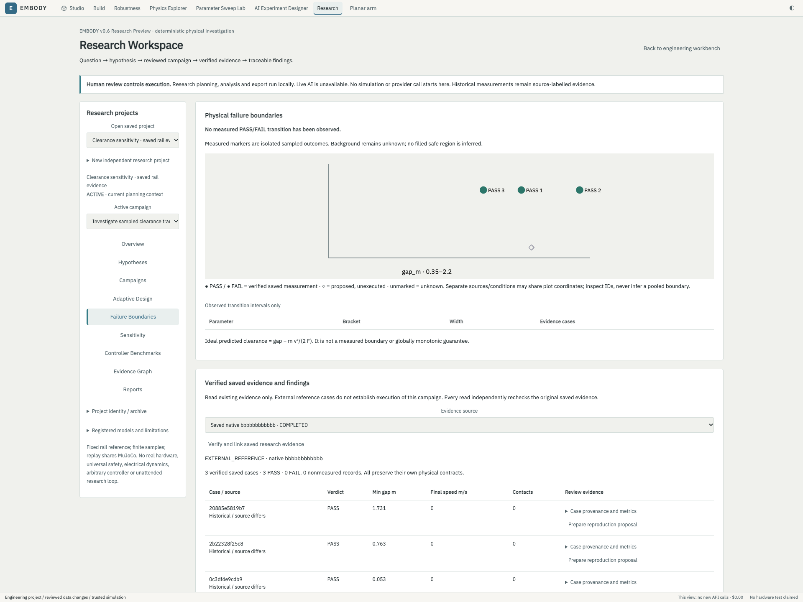
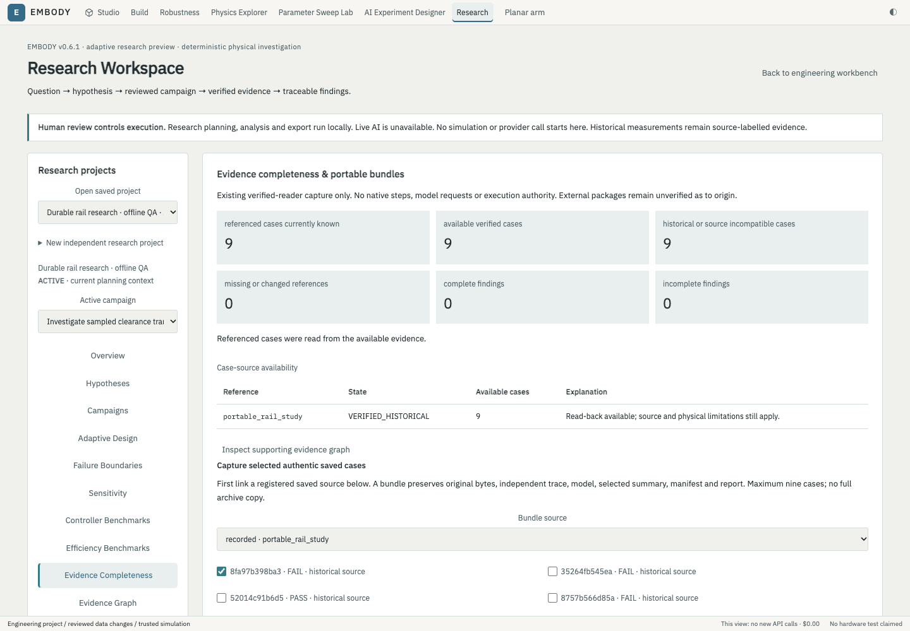
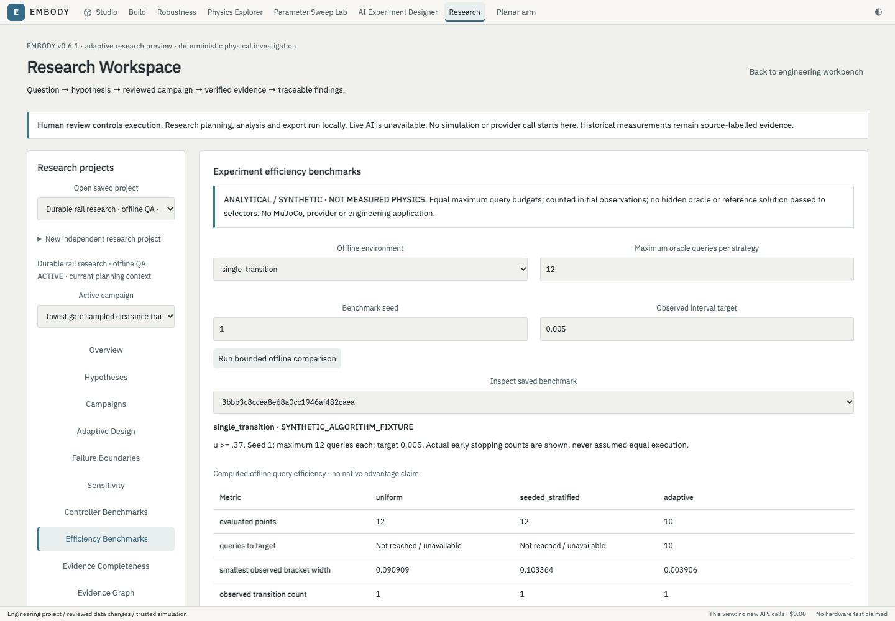

# Research Workspace — v0.6.2 verified adaptive physical debugging

Open **Simulate → Open Research Workspace**, or **Advanced workspaces → Research**.
This is a deterministic research workflow. Production live AI planning, hypotheses,
interpretation and report drafting remain unavailable. No new provider client,
financial ledger or approval shortcut is introduced.

Create an independent research project with a title, engineering question and
registered model. It never replaces or edits the authoritative robot project.
Add/edit structured human hypotheses, variables, expected direction, assumptions,
evaluation method and unresolved questions. A mathematical expectation is not an
empirical finding; hypotheses remain proposed/under investigation.

Create a campaign, choose one/two physical axes, fixed SI parameters, criteria,
strategy, seed, batch size, spacing and proposal budget. Actual catalog bounds
are authoritative. Generate initial samples, inspect ideal predictions, then
explicitly review or reject a batch. Transfer the exact reviewed batch into
Parameter Sweep Lab. Nonuniform batches use a read-only point table; no fictitious
rectangular grid or historical scenario is substituted. Its existing native
confirmation remains a separate decision. The completed v0.6.2 demonstration
measured three initial cases and one separately approved refinement, with a fresh
replay per case. [Measured results and limits](ADAPTIVE_PHYSICAL_DEBUGGING.md) are
public; any additional experiment still needs separate execution authority.

Link a saved local native job or the public pinned nine-run rail study. Existing
readers verify hashes and contracts. External references are not execution of a
new campaign. Current-source exact-case/criteria reviewed matches alone may count
as submitted campaign evidence. Physical FAIL and execution error remain separate.
A completion check refuses incomplete, unmatched or invalidated evidence.

Inspect sampled boundaries, analytical/measured sensitivity and eligible benchmark
cohorts. Adaptive candidates have explicit deterministic rationales, neighbors,
scores and stopping reasons. Select individual candidates, then create another
unreviewed batch; never an automatic loop. A reproduction proposal reconstructs
only supported numbers, preserves old source provenance and requires new review.

Record a finding by selecting an exact nonmissing verified numerical fact. No
free-form numerical finding editor can manufacture a measurement. The accessible
evidence graph traces the finding to its case, execution reference and digests.
Changed/unavailable evidence removes its verified status. Reports include the
selected campaign, chosen hypotheses and optional deterministic discussion;
export Markdown, JSON and a reproducibility manifest.

## Persistence and states

Ignored `.runtime/research/` retains at most8 projects,12campaigns/project,
16hypotheses,32findings,16open questions,128events/project,16batches/campaign,
100unique proposed points/campaign and25points/batch. JSON snapshot/manifest limit
120000bytes. Every mutation checks the exact research head digest. Snapshots are
write-once; a small atomic pointer selects the head. Loading validates schemas,
batch identities, domains and references. No arbitrary output path is accepted.
Archive preserves all files and makes a project read-only. Quota exhaustion never
deletes unrelated files. Export and operator preservation are required before
future maintenance; there is no automatic pruning.

Campaign lifecycle: DRAFT → AWAITING_REVIEW → REVIEWED → TRANSFERRED. Linking an
exact current reviewed result may establish PARTIAL/MEASURED; explicit completion
requires every nonrejected batch measured. CANCELLED and ARCHIVED close planning;
research cancellation does not cancel a separate native job. Interrupted native
jobs remain consumed and are never restarted by Research. External references
leave execution state unchanged. Events record actual local mutations, not
invented approvals or model/simulation activity. Read-only exports do not invent
persistent execution events.

Research context binds existing Designer/catalog source and all research modules.
Source drift blocks new mutation/review/transfer. Existing historical evidence
retains its identity and may still be inspected; it is not migrated into fresh
current-source verification. Async project/campaign responses are identity-bound
and obsolete responses are discarded.

## Registered scope and limitations

Only `rail_velocity_brake_v1` / `developer_velocity_brake_v1` executes through the
existing trusted reference service. Numeric bounds remain mass1–4kg, speed0–1.2m/s,
force2–6N, gap0.35–2.2m. Mandatory clearance≥.05m, final speed<.03m/s, horizon3s and
zero wall-contact episodes can only be tightened. The independent native admission,
600primary/600replay steps,25serial cases,60s cooperative deadline and job lock
are unchanged.

A second descriptor exposes the actual existing public RampService angle,
length/width/thickness and friction metadata. **Research rover execution is
unavailable.** It does not expose invented rover mass, torque or tire sweep knobs,
copy private ramp archives or infer an electromechanical powertrain. No ramp
analytical model is claimed. Candidate rail controllers are offline mathematical
metadata, not new executable registrations.

Finite proxy samples do not prove continuous robustness, manufacturing/material
fidelity or real-world safety. Replay shares MuJoCo, not a second physics engine.
CIRCUITBASE remains static checking, not coupled electrical/thermal simulation.
No arbitrary controller/source/XML/plugin execution, automatic application,
provider spending, VM or unattended adaptive run exists in Research.

See [adaptive algorithms](ADAPTIVE_EXPERIMENT_DESIGN.md),
[boundary semantics](FAILURE_BOUNDARY_ANALYSIS.md),
[sensitivity](PARAMETER_SENSITIVITY.md), [benchmarks](CONTROLLER_BENCHMARKING.md)
and [reproducibility](RESEARCH_REPRODUCIBILITY.md).

## Earlier preview product views

The captures are genuine local Chrome UI. Plans and adaptive suggestions are
explicitly deterministic; measurements are existing saved evidence, never new
native or AI execution.

Additional views: [adaptive proposals](assets/product/adaptive-experiment-designer.png),
[parameter sensitivity](assets/product/parameter-sensitivity.png),
[controller registry / insufficient matched cohorts](assets/product/controller-benchmark.png),
[exact finding provenance](assets/product/research-evidence-graph.png),
and [deterministic report preview](assets/product/research-report.png).

The eight product captures above were taken before the final interruption. Their
three-case native reference and combined12case views are genuine observed saved
evidence, but that private temporary raw bundle is now unavailable. Do not treat
those screenshots as portable raw verification. Retained final QA uses the nine
public pinned runs; current-controller adaptive guidance remains unavailable
without suitable native records or a separately approved new experiment. Those
earlier missing v0.4 records remain missing. The new v0.6.2 study has separate
retained raw evidence and [public exports](../examples/adaptive-rail-study/README.md);
it is not a reconstruction or replacement of the old missing run.

## v0.6.1 / v0.6.2 adaptive preview

Evidence Completeness captures selected genuine pinned data into durable bundles;
package verification/import preserves external-origin status. Efficiency Benchmarks
compares three algorithms using bounded analytical/synthetic oracles, with actual
query counts and no physics execution. Sensitivity adds measured/ideal residuals;
Adaptive Design shows available matching measured results by reviewed batch,
otherwise NOT_ESTABLISHED. Optional 1D resolution is in the axis's SI unit.

The earlier preview performed zero native steps. The subsequent separately
approved initial 1.44/1.49/1.54 m cases and measured-guided 1.465 m refinement
are now complete: four cases/eight rollouts/4,800 steps, all replay/readback PASS.
The observed interval narrowed from 50 to 25 mm; no native efficiency advantage
is claimed. See the [completed demonstration](ADAPTIVE_PHYSICAL_DEBUGGING.md),
[evidence](RESEARCH_EVIDENCE.md),
[offline benchmarks](EXPERIMENT_EFFICIENCY.md) and [release checks](RESEARCH_RELEASE.md).

## Durable evidence and offline benchmark views

These are genuine final Chrome captures over the pinned historical study and
computed analytical/synthetic benchmarks. None claims new native dynamics.

[Oracle query and bracket curves](assets/product/experiment-efficiency-benchmark.png),
[unexecuted native round](assets/product/adaptive-research-progress.png),
[saved measured/ideal residuals](assets/product/analytical-measured-comparison.png) and
[actual report](assets/product/reproducible-research-report.png) remain separately labelled.
