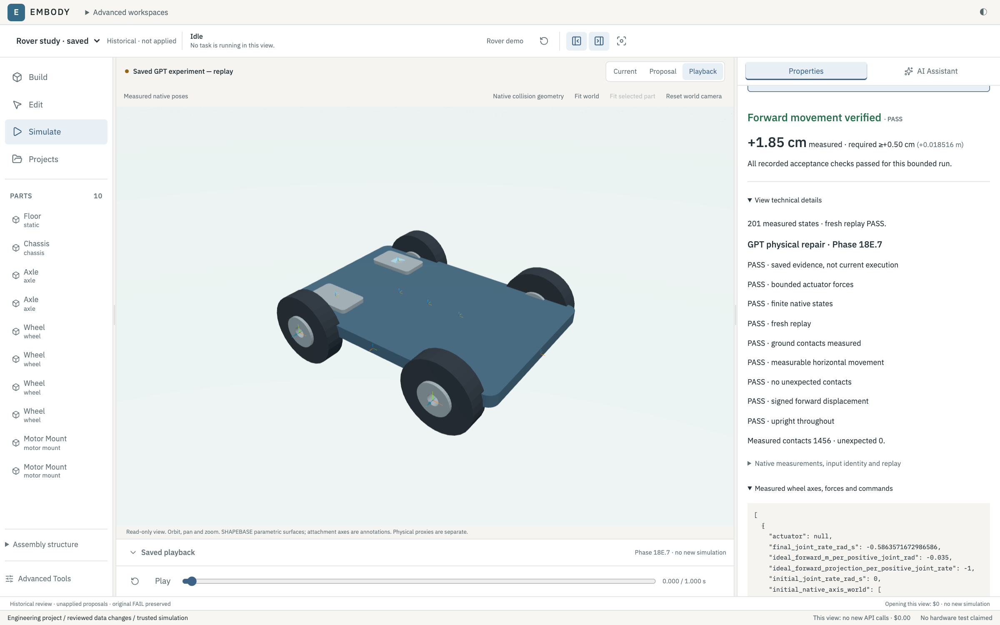

# Verification

A schema-valid proposal, compiled geometry, successful replay and physical requirement PASS are different results.

## Saved measured comparison

The [machine-readable summary](assets/product/verification-summary.json) describes two genuine, separate model-authored experiments:

| Saved case | Rear commands, each | Signed travel | Direction verdict |
|---|---:|---:|---|
| Initial construction |+0.012 N·m|−0.018516 m|FAIL|
| Later command repair |−0.012 N·m|+0.018516 m|PASS|

The requirement was at least +0.005 m along the initial chassis forward axis in one second. Both saved trajectories have a fresh native replay; only the repaired case passed the full directional requirement. Neither proposal was applied. A separate replay uses the same MuJoCo engine and predicates, not an independent physics engine or a formal safety proof.



This is a current review of saved native evidence. Opening the image or workspace does not rerun the experiment.

## Portable saved-data checks

The default [rail-braking study](../examples/rail-braking-study/README.md) is a
separate, explicitly derived public package. Original inventories and private
records remain unchanged. Only reviewed path metadata was projected; original
and public hashes are recorded separately. Controller bytes, physical samples,
XML, independent traces, verdicts and 51 native PNGs retain their source identity
or exact numerical content. The existing bounded reader is unchanged.

```sh
.venv/bin/python -m pytest -ra tests/test_public_recording.py
npm --prefix frontend test
npm --prefix frontend run typecheck
npm --prefix frontend run build
.venv/bin/python -m tools.start --check
```

The saved-data suite performs no dynamics. An extended read-only suite also
covers the legacy Streamlit viewer and the original empty-project identity test;
its Streamlit dependency is declared in `requirements-workspace.txt`.

| Current executed check | Preserved workspace | Isolated exact Git candidate |
|---|---|---|
| Saved-data, legacy viewer and project identity | 46 passed; 0 failed | 46 passed; 0 failed |
| Frontend | 171 passed | 39 passed across the six changed-import test files |
| TypeScript / production build | PASS / PASS | PASS / PASS |
| Launcher readiness | READY | READY |
| Saved A/B/C API reads | Existing reader exercised by tests | HTTP 200 for all three |

The isolated candidate used existing installed dependencies, with an explicit
guard denying original workspace source/evidence reads. The guard recorded zero
such reads. Native integration calls were prohibited during read-only Python
checks. No model request, VM, application or fresh simulation occurred.

The previous missing original-project fixture is now included as two reviewed,
byte-identical anonymous files. Its original assertion passes unchanged. The
previous absolute-reference failure is resolved by package-local metadata;
foreign absolute references, traversal, symlinks, unindexed files and altered
bytes still reject. Private raw reports/accounting are explicitly unavailable,
not advertised as included evidence.

## Broader regression and release scope

The full historical Python suite is for the preserved workspace and needs private
archives. It is not a fresh-clone acceptance command and was not rerun here.
Previous complete and interrupted full-run logs remain private historical evidence;
only the current targeted results above are claimed for this packaging change.

The developer-authored typed rover example remains independently schema-valid;
that check is neither model authorship nor a new physical PASS. Saved rover
measurements in the comparison above are separate from the rail package.

Advanced rover, arm, robustness and construction-review archives remain private.
This package does not silently replace their evidence. The publication worker uses two fixed real host canaries, with no externally
supplied probe path. The qualifier checks their independence and retains all original
assertions. These exact source identities passed the complete separately approved
private-installation qualification on 27 October 2026: all 32 assertions, original
trusted A/B/C parity, 17 serial attempts and strict cleanup. This public tree
excludes private baseline records, runtime configuration and certificates.
It grants no VM execution authority; another deployment needs its own valid
installation-bound qualification and explicit approval. No commit, push or
upload was performed by these checks. Proxy verification never establishes universal or
real-world safety.
