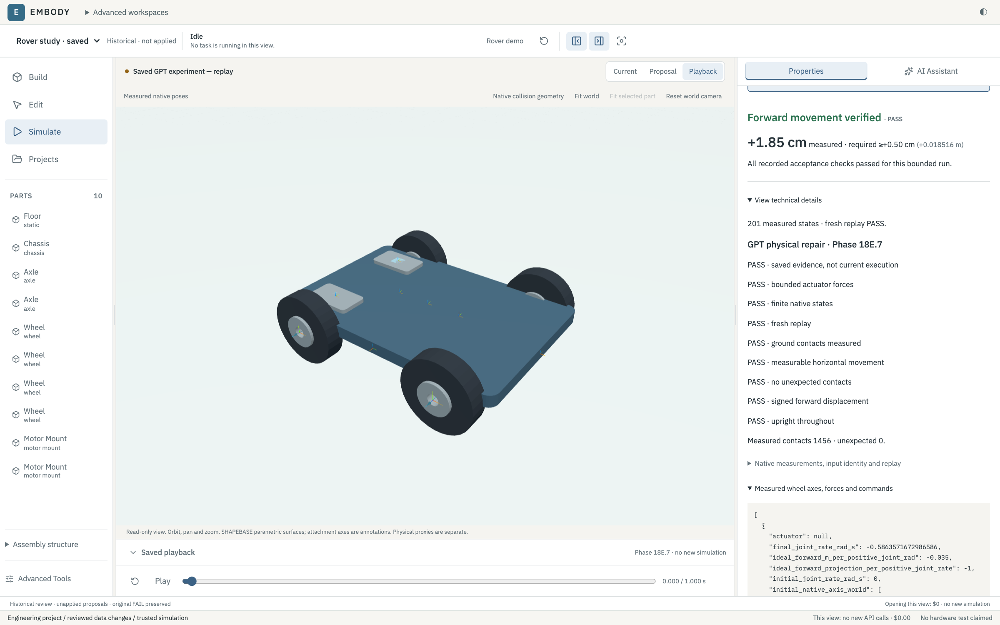
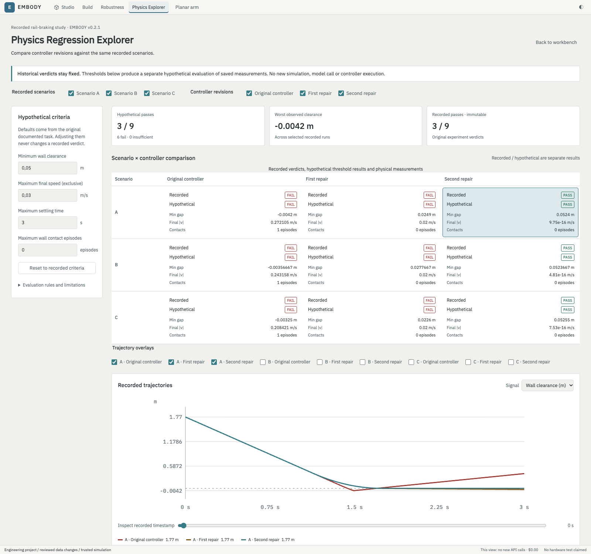

# Verification

A schema-valid proposal, compiled geometry, successful replay and physical requirement PASS are different results.

## Saved measured comparison

The [machine-readable summary](assets/product/verification-summary.json) describes two genuine, separate model-authored experiments:

| Saved case | Rear commands, each | Signed travel | Direction verdict |
|---|---:|---:|---|
| Initial construction |+0.012 N·m|−0.018516 m|FAIL|
| Later command repair |−0.012 N·m|+0.018516 m|PASS|

The requirement was at least +0.005 m along the initial chassis forward axis in one second. Both saved trajectories have a fresh native replay; only the repaired case passed the full directional requirement. Neither proposal was applied. A separate replay uses the same MuJoCo engine and predicates, not an independent physics engine or a formal safety proof.



This is a current review of saved native evidence. Opening the image or workspace does not rerun the experiment.

## Portable saved-data checks

The default [rail-braking study](../examples/rail-braking-study/README.md) is a
separate, explicitly derived public package. Original inventories and private
records remain unchanged. Only reviewed path metadata was projected; original
and public hashes are recorded separately. Controller bytes, physical samples,
XML, independent traces, verdicts and 51 native PNGs retain their source identity
or exact numerical content. The existing bounded reader is unchanged.

```sh
.venv/bin/python -m pytest -ra tests/test_public_recording.py
npm --prefix frontend test
npm --prefix frontend run typecheck
npm --prefix frontend run build
.venv/bin/python -m tools.start --check
```

The saved-data suite performs no dynamics. An extended read-only suite also
covers the legacy Streamlit viewer and the original empty-project identity test;
its Streamlit dependency is declared in `requirements-workspace.txt`.

| Current executed check | Preserved workspace | Isolated exact Git candidate |
|---|---|---|
| Saved-data, legacy viewer and project identity | 46 passed; 0 failed | 46 passed; 0 failed |
| Frontend | 171 passed | 39 passed across the six changed-import test files |
| TypeScript / production build | PASS / PASS | PASS / PASS |
| Launcher readiness | READY | READY |
| Saved A/B/C API reads | Existing reader exercised by tests | HTTP 200 for all three |

The isolated candidate used existing installed dependencies, with an explicit
guard denying original workspace source/evidence reads. The guard recorded zero
such reads. Native integration calls were prohibited during read-only Python
checks. No model request, VM, application or fresh simulation occurred.

The previous missing original-project fixture is now included as two reviewed,
byte-identical anonymous files. Its original assertion passes unchanged. The
previous absolute-reference failure is resolved by package-local metadata;
foreign absolute references, traversal, symlinks, unindexed files and altered
bytes still reject. Private raw reports/accounting are explicitly unavailable,
not advertised as included evidence.

## Broader regression and release scope

The full historical Python suite is for the preserved workspace and needs private
archives. It is not a fresh-clone acceptance command and was not rerun here.
Previous complete and interrupted full-run logs remain private historical evidence;
only the current targeted results above are claimed for this packaging change.

The developer-authored typed rover example remains independently schema-valid;
that check is neither model authorship nor a new physical PASS. Saved rover
measurements in the comparison above are separate from the rail package.

Advanced rover, arm, robustness and construction-review archives remain private.
This package does not silently replace their evidence. The publication worker uses two fixed real host canaries, with no externally
supplied probe path. The qualifier checks their independence and retains all original
assertions. These exact source identities passed the complete separately approved
private-installation qualification on 27 October 2026: all 32 assertions, original
trusted A/B/C parity, 17 serial attempts and strict cleanup. This public tree
excludes private baseline records, runtime configuration and certificates.
It grants no VM execution authority; another deployment needs its own valid
installation-bound qualification and explicit approval. No commit, push or
upload was performed by these checks. Proxy verification never establishes universal or
real-world safety.


## Physics Regression Explorer



The v0.2.1 explorer compares the portable rail study through the existing read-only experiment, file and proposal APIs. Open **Simulate → Open Physics Regression Explorer** in the workbench, **Advanced workspaces → Physics Explorer**, or the comparison button in the legacy **Physics** panel. The view is independent of unavailable private rover/arm archives. Back to workbench retains the existing project and review state.

Select any of scenarios A/B/C and the original controller, first repair or second repair. Each matrix cell keeps two separate results: the **recorded historical verdict**, which is immutable, and a **hypothetical threshold evaluation** of saved measurements. Selecting a cell exposes the recorded independent execution status, original failure reasons, metrics and checksum-matched saved controller source/diff. Source is displayed only; it is never executed or applied.

The original documented defaults are 0.05 m clearance, final speed strictly below 0.03 m/s, a 3 s deadline and zero wall-contact episodes. All three originals and first repairs retain their recorded FAIL; all three second repairs retain recorded PASS. The first repair avoids contact but has insufficient clearance. Lowering a hypothetical clearance limit can change the derived result while its recorded FAIL remains unchanged.

| Quantity | Extraction and boundary meaning |
|---|---|
| Minimum wall clearance | Saved acceptance aggregate, checked against all available measured clearance samples. Inclusive requirement with the existing 1e−12 m tolerance. |
| Final absolute speed | Saved aggregate checked against the absolute last sampled velocity. Strictly below the selected limit; equality fails. |
| Peak absolute velocity | Maximum absolute measured velocity; unavailable if the complete velocity series is unavailable. No invented peak/force certification. |
| Wall-contact episodes / samples | Rising edges of the recorded wall-collision signal versus individual contact-bearing samples. The hypothetical episode limit is an inclusive nonnegative integer. |
| Sampled settling time | New derived analysis: the first saved sample whose whole remaining saved velocity suffix stays strictly below the selected speed limit. Time requirement is inclusive with 1e−12 s tolerance. This is not exact zero-speed stopping time. |

The default settling deadline reuses the original completion deadline numerically. It is a distinct exploratory criterion: the recorded acceptance also checked full-horizon completion and finite measurements. Changing the speed threshold recomputes settling time. If settling is absent and the selected deadline is covered by the recording, that criterion fails. If the deadline extends beyond the available recording, its result is **Insufficient data**. Known failures remain failures even when another selected metric is unavailable. No extrapolation beyond the saved horizon is performed. Missing/invalid metrics stay unavailable; they are never converted to zero. Conflicting aggregate/sample measurements are withheld. Invalid/nonfinite thresholds withhold all hypothetical results while retaining historical results.

The default worst-case ranking uses clearance margin. It can instead rank speed, settling-time or contact-episode headroom. Rankings compare one unit at a time; unlike dimensions are never mixed into a safety score. The interpretation also reports worst observed clearance, selected-run pass/fail/insufficient counts, the most frequently failing criterion and revision-level changes in worst observed clearance. These are deterministic descriptive summaries, not probabilities or universal robustness estimates.

Trajectory overlays use actual saved position, signed velocity and wall-clearance samples. Choose any runs and signal; the cursor selects an actual recorded timestamp. Each run keeps its own domain. Missing values break a line, and a run without a sample at the cursor is reported as such. No resampling or synthetic samples are introduced. SVG chart conventions follow the existing telemetry UI without adding a charting dependency. The existing two-run telemetry component assumes a shared time grid, so the new reusable multi-run plot explicitly handles different domains.

No API model request, VM, new integration, controller application or qualification change is part of this feature. Existing saved independent MuJoCo verification is displayed, not rerun. Passing selected thresholds means only passing those criteria over the available recorded samples. It does not prove real-world safety, arbitrary-program correctness or generalization beyond the three scenarios.

Focused frontend checks (no backend changes):

```sh
npm --prefix frontend test -- src/physicsRegression.test.ts src/PhysicsRegressionExplorer.test.tsx src/PhysicsPanel.test.tsx src/App.test.tsx src/UnifiedWorkspace.test.tsx src/playback.test.ts
npm --prefix frontend run typecheck
npm --prefix frontend run build
```


## Parameter Sweep Lab and trusted native execution

Open **Simulate → Open Parameter Sweep Lab**. Analytical previews remain separate
from explicit **Run Simulation Sweep → Confirm and run trusted sweep**. Only the
fixed registered developer velocity brake may run: never a historical/GPT repair,
uploaded source, supplied XML/module/controller/executable/output path.

The unchanged rail model/context builder and runner perform 600 primary native
steps per case; fresh direct native replay performs 600 more. State, geometry,
forces and contact IDs are checked independently. Hard original rail predicates
remain mandatory alongside selected criteria. No protected qualification source
or candidate-execution boundary changes.

The real demonstration passed three cases and fresh replay: ordinary .4 m/s at
2 kg, heavier/higher-speed 1.2 m/s at 4 kg, and a near-limit challenge with a
1.49 m initial gap. Minimum measured gaps were 1.731 / .763 / .053 m, final speeds
zero, no contact samples; all PASS. This consumed six actual native rollouts,
3,600 total steps. No measured failure boundary was observed. Browser QA uses
these saved results without additional integration.

Final checks: **34 non-native backend/security tests + 1 separate real-native
integration test**, **120 targeted frontend tests**, TypeScript and production
build PASS. Test doubles cover error/cancellation/protocol cases and are not
native evidence. No broad historical suite or VM test batch ran. See the
[complete feature guide](PARAMETER_SWEEP_LAB.md) for exact bounds, persistence,
measurement definitions and limitations.


## AI Experiment Designer: validated planning, not live AI

The [Designer guide](AI_EXPERIMENT_DESIGNER.md) documents strict proposal validation,
manual review/transfer and verified saved-fact interpretation. Offline test doubles
reuse the existing provider abstraction; no genuine provider request or additional
native rollout was authorized or made. The v0.4 native integration test was not
rerun. Historical saved results are externally linked, source-labelled evidence,
not executions of a new manual proposal.

The targeted suites cover proposal/units/limits/stale identity, attempted safety
weakening, typed mock responses, unavailable/denied model paths, numerical fact
checks, partial/corrupt records, independent follow-ups, real App transfer, no
automatic native call and portable exports. Existing qualification paths and
native admission remain unchanged. The existing oversized-body test's fixture now
sends only its oversized declared Content-Length: the server must still return400
before reading a body. This removes the reset race without changing a guard.

Suggested focused checks (exclude the consumed native integration test):

```sh
.venv/bin/python -B -m pytest -ra -p no:cacheprovider tests/test_experiment_designer.py tests/test_rail_sweeps.py tests/test_ide_api.py::test_host_origin_csrf_and_bounded_strict_json tests/test_ide_api.py::test_bootstrap_does_not_load_credentials_run_physics_or_call_model tests/test_ide_api.py::test_one_expensive_job_at_a_time
npm --prefix frontend test -- src/AIExperimentDesigner.test.tsx src/TrustedSweepPanel.test.tsx src/parameterSweep.test.ts src/ParameterSweepLab.test.tsx src/physicsRegression.test.ts src/PhysicsRegressionExplorer.test.tsx src/App.test.tsx src/PhysicsPanel.test.tsx src/UnifiedWorkspace.test.tsx src/playback.test.ts
npm --prefix frontend run typecheck
npm --prefix frontend run build
```


## Research Preview verification scope

New tests in `test_research_algorithms.py`, `test_research_workflow.py` and
`test_research_http.py` cover strict domain/state/storage/import contracts,
fixed-condition sampling/adaptive algorithms, boundary and sensitivity semantics,
constrained Pareto analysis, graph references/DAG, exact facts, report integrity,
real pinned historical readers, source drift and guarded HTTP/native admission.
Synthetic lifecycle/algorithm fixtures are explicitly test-only, not physics.
Provider creation and native stepping are forbidden in new backend fixtures.
`ResearchWorkspace.test.tsx` covers actual typed UI flow and stale selection races.

The focused non-native regression passed165tests,0fail/skip/deselected. Relevant
frontend regression passed143tests across11files; production typecheck/build
passed with the existing chunk-size warning. Full historical/native/VM suites
were not rerun. Browser screenshots and exact final verification details are
recorded in the private feature report; no new current-source native adaptive
result or live AI success is claimed. See [research limitations](RESEARCH_WORKSPACE.md).

```sh
.venv/bin/python -B -m pytest -ra -p no:cacheprovider tests/test_research_algorithms.py tests/test_research_workflow.py tests/test_research_http.py tests/test_experiment_designer.py tests/test_rail_sweeps.py tests/test_ide_api.py::test_host_origin_csrf_and_bounded_strict_json tests/test_ide_api.py::test_bootstrap_does_not_load_credentials_run_physics_or_call_model tests/test_ide_api.py::test_one_expensive_job_at_a_time
npm --prefix frontend test -- src/ResearchWorkspace.test.tsx src/AIExperimentDesigner.test.tsx src/TrustedSweepPanel.test.tsx src/parameterSweep.test.ts src/ParameterSweepLab.test.tsx src/physicsRegression.test.ts src/PhysicsRegressionExplorer.test.tsx src/App.test.tsx src/PhysicsPanel.test.tsx src/UnifiedWorkspace.test.tsx src/playback.test.ts
npm --prefix frontend run typecheck
npm --prefix frontend run build
```

Native `test_rail_sweeps_native.py` is intentionally excluded. Its prior budget
is consumed; a new finite current-source demonstration needs explicit approval.


Final genuine Chrome acceptance passed24journey classes with0page errors and
two expectedHTTP400responses (invalid domain and unknown manifest import).
The release pass used installedChrome157 with actual local handlers, genuine3saved
native cases plus9pinned historical runs,0provider/native/apply requests. Independent
read-back reconstructed the exact12case view,15native metric facts, report and
browser-serialized manifest without integration. Public screenshots show actual
manual/deterministic planning and source-labelled historical measurements.


### Retained final verification after interruption

The temporary audit directory disappeared before final delivery. Its earlier
165-backend/143-frontend/24-Chrome PASS outputs were observed during the session,
but their missing raw logs are not reconstructed here. The eight captured public
PNGs remain authentic prior captures. Raw private v0.4 three-case records are
currently unavailable and were not regenerated.

Fresh retained logs under ignored `.runtime/v06_verification/` show165backend
PASS,0FAIL/SKIP/DESELECTED; typecheck/build PASS; and23genuine Chrome checks over
the nine pinned public recordings (3PASS/6FAIL). The frontend recovery run had
141PASS/2existing UI wait failures during concurrent build load; the two affected
suites then passed24/24alone with no source/assertion changes. Counts overlap.
No failing result is erased. No new native/provider/VM execution occurred.
Independent read-back matches the actual nine-case view, manifest, report and27
sample-derived metric facts. The unavailable private native data cannot currently
support fresh read-back; current-reference adaptive guidance correctly reports
insufficient comparable evidence. Synthetic algorithm fixtures remain test-only.
